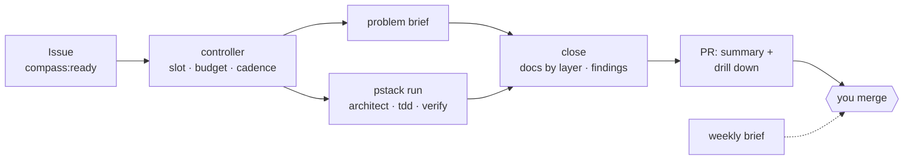

# compass-labs

A Claude Code plugin for busy people on a Claude **subscription** who want their side projects to keep moving. You set the vision and review one PR at a time, about an hour a week. Claude does the work in between: [pstack](https://github.com/cursor/plugins/tree/main/pstack) builds, Compass schedules the runs within your usage budget, keeps the docs and findings indexed, and sends you one short visual brief a week.

**How it works** ([full before/after](docs/explanation/workflow-today-vs-future.html)):



- **One stop per feature: the merge.** A hook blocks every other route to the default branch.
- **The detail is there when you want it.** The PR leads with a short summary, and a collapsed *Drill down* section links the brief, the findings, the decision trail and the docs it touched.
- **Monthly cadence:** weeks 1–3 work your side projects, and the last 7 days work compass-labs itself, resolving the `compass` findings collected that month. The weekly brief tracks the split against 3:1.

Skills are invoked as `/compass-labs:<skill>`. Renaming the prefix is tracked in #34.

<!-- compass:anchor -->
## Project anchor

### Vision

Busy people keep their side projects moving with an hour a week, by setting direction while Claude does the work between reviews.

### Mission

compass-labs is a Claude Code plugin that runs a project forward unattended and within a Claude subscription. Proven tools do the work, and compass-labs adds the layer around them:

- pstack for building, with Karpathy's rules and pstack's principles for behaviour
- a controller for scheduling, budget and cadence
- a short problem brief and an indexed docs-and-findings fold-back (`close`)
- one visual weekly brief

### Scope

- Works in any repository, independent of tech stack. Mycelia is the first test project, not the target.
- Scheduling within subscription usage limits, the monthly side/compass cadence, and its metric.
- Brief-first artifacts: a PR summary with drill-down, problem briefs, findings, the docs index by layer, release records.
- Guardrails: subscription-safe models, and only the user merges.
- Supporting skills: project initialisation, deploy, architecture decisions, backlog triage.

### Non-goals

- A runtime, framework or hosted service.
- Replacing the user's approval at merge.
- Rebuilding what a proven tool already does (pstack, graphify, Claude Design).
- Long artifacts nobody reads: anything over a page gets a summary and a drill-down.
<!-- /compass:anchor -->

## Installation

compass-labs needs **[pstack](https://github.com/cursor/plugins/tree/main/pstack)** (by Lauren Tan, MIT) as its work layer ([ADR-011](docs/registry/decisions/011-adopt-pstack-work-layer.md)). It's declared as a plugin dependency, so installing compass-labs installs pstack too. Claude Code only resolves a dependency from a marketplace you've added, so add pstack's marketplace first.

Requires Claude Code v2.1.265 or later.

### Option 1: Permanent (recommended)

```bash
# 1. Add pstack's marketplace (Cursor's official plugins repo)
claude plugin marketplace add cursor/plugins

# 2. Add compass-labs' marketplace
claude plugin marketplace add dkoenawan/compass-labs     # or a local clone: /path/to/compass-labs

# 3. Install compass-labs (pstack installs with it as a dependency)
claude plugin install compass-labs@compass-labs
#   ✔ Successfully installed plugin: compass-labs@compass-labs (scope: user) (+ 1 dependency: pstack)
```

Then, in a Claude Code session:

```text
/compass-labs:setup
```

This writes pstack's **subscription-safe model settings** to `~/.claude/rules/pstack-models.md`: Claude models only, nothing above `high` reasoning. pstack's own defaults include Fable, which needs usage credits, and Gemini, which needs another account. On a Claude subscription those roles fail or cost extra. Until setup has run, every session starts with a one-line reminder.

Check it worked:

```bash
claude plugin list    # compass-labs@compass-labs and pstack@cursor-plugins: ✔ enabled
```

Skipped step 1? The install still succeeds, but compass-labs shows `✘ failed to load: Dependency "pstack@cursor-plugins" is not installed`. Run step 1, then `claude plugin install pstack@cursor-plugins`.

To update: `claude plugin update compass-labs@compass-labs`. pstack stays on the version you installed, because Claude Code leaves auto-update off for third-party marketplaces. Update it on purpose with `claude plugin update pstack@cursor-plugins`.

**Upgrading from 2.4.x:** run step 1 and `claude plugin install pstack@cursor-plugins`, then `/compass-labs:setup`.

### Option 2: Session-only (quick test)

Loads compass-labs for one session. pstack still has to be installed (Option 1, steps 1 and 3), or loaded alongside it:

```bash
claude --plugin-dir /path/to/compass-labs
```

### pstack, Cursor and other installs

| Situation | Works? | Notes |
|---|---|---|
| You also use **pstack in Cursor** | ✅ Yes, side by side | Claude Code's copy lives in `~/.claude/plugins/` and reads its settings from `~/.claude/rules/pstack-models.md`. Cursor's pstack is installed through Cursor and reads `~/.cursor/rules/pstack-models.mdc`. compass-labs never writes under `~/.cursor/`, so Cursor keeps its own models (including Gemini, which Cursor bills). Cursor's docs say it also loads skills from `~/.claude/skills/`, but plugin skills live elsewhere, so Cursor won't see compass-labs or Claude's pstack copy. This is based on both tools' docs and hasn't been tested in Cursor |
| You run **`/pstack:setup-pstack` in Claude Code** | ⚠️ Overwrites Compass's settings | It rewrites `~/.claude/rules/pstack-models.md` with pstack's defaults. The next session warns you. Run `/compass-labs:setup` to restore the safe settings (a backup of yours is kept) |
| You have the **community port** `pstack@pstack-claude` installed | ❌ Not supported together | Both register `/pstack:` commands. Uninstall the port: `claude plugin uninstall pstack@pstack-claude`. compass-labs is written and tested against the official `pstack@cursor-plugins` |
| You use pstack in **Codex, Copilot or another tool** | ✅ Unaffected | compass-labs only touches Claude Code's config |

## Plugin Structure

```
compass-labs/
├── .claude-plugin/
│   ├── plugin.json          # Manifest; depends on pstack@cursor-plugins
│   └── marketplace.json     # Lists every shipped skill; allowlists cursor-plugins
├── skills/
│   ├── setup/               # pstack's subscription-safe model settings
│   ├── controller/          # Scheduled runs: slots, budget, cadence, brief ∥ pstack → close
│   ├── problem-statement/   # The short problem brief (docs/briefs/)
│   ├── close/               # As-built docs, docs index by layer, findings, PR drill-down
│   ├── brief/               # The weekly visual brief (one GitHub issue)
│   ├── deploy/              # Deploy standard, release records (docs/releases/), starter workflow
│   ├── triage/              # Backlog stock-take, weekly report
│   ├── adr/                 # MADR architecture decisions
│   └── init/                # New-project scaffolding and brownfield registry
├── hooks/
│   ├── hooks.json
│   ├── merge-guard.sh       # Only you merge: blocks gh pr merge and pushes to the default branch
│   ├── session-start.sh     # Warns when pstack's settings aren't subscription-safe
│   └── lib/                 # Command parser, default-branch lookup
├── docs/                    # Diátaxis docs, ADRs (docs/registry/decisions), sessions history, archive
└── tests/                   # bash + jq harness: bash tests/run.sh
```

## Skills Included

| Skill | Use it to |
|---|---|
| `/compass-labs:setup` | Install pstack's subscription-safe model settings, once after installing |
| `/compass-labs:controller [status\|plan\|run\|install\|uninstall]` | Schedule unattended runs. `plan` shows what the next run would pick |
| `/compass-labs:problem-statement <issue>` | Write a short problem brief (about 25 lines, one diagram) |
| `/compass-labs:close [branch\|PR]` | After a run: update docs and the layer index, write findings, add PR drill-down |
| `/compass-labs:brief [preview\|publish]` | The weekly brief: PRs to review, cadence pie, usage, findings |
| `/compass-labs:deploy [starter]` | Deploy a change on demand and write its release record |
| `/compass-labs:triage` | Stock-take of open issues, and the weekly report schedule ([how to](docs/how-to/run-triage.md)) |
| `/compass-labs:adr` | Record a significant decision (MADR) |
| `/compass-labs:init` | Scaffold a new project (default stack: [`stack-defaults.md`](skills/init/reference/stack-defaults.md)), or seed a registry from an existing one |
| `/pstack:poteto-mode <task>` | (from pstack) Do one task by hand. Follow it with `/compass-labs:close` |

### A week, by hand or scheduled

1. **Label** what's ready: `gh issue edit <n> --add-label compass:ready`.
2. **Let it run.** The controller takes one issue per slot (`/compass-labs:controller install`), or you run `/pstack:poteto-mode #<n>` and then `/compass-labs:close`.
3. **Review** in your hour. Read the Monday brief, open the PRs, drill down where you need to, and merge.

The retired gated Feature session, its standards and the skills that pstack or graphify now cover are documented in [`docs/archive/`](docs/archive/README.md). Past sessions stay in [`docs/sessions/`](docs/sessions/), and overridden ADRs are listed as Archived in the [ADR index](docs/registry/decisions/index.md).

## Development

To develop this plugin locally:

1. Clone the repository
2. Make changes to skills, commands or hooks
3. Run the test harness: `bash tests/run.sh`
4. Test live using `claude --plugin-dir .`
5. Submit pull requests for improvements

## Contributing

Contributions are welcome! Please feel free to submit pull requests or open issues for:

- New skills for systematic development workflows
- Improvements to existing skills
- Documentation enhancements
- Bug fixes

## License

MIT License - see [LICENSE](LICENSE) file for details.

## Author

Daniel Koenawan

## Resources

- [Claude Code Plugin Documentation](https://code.claude.com/docs/en/plugins)
- [Skills Guide](https://code.claude.com/docs/en/skills)
- [Plugin Reference](https://code.claude.com/docs/en/plugins-reference)
