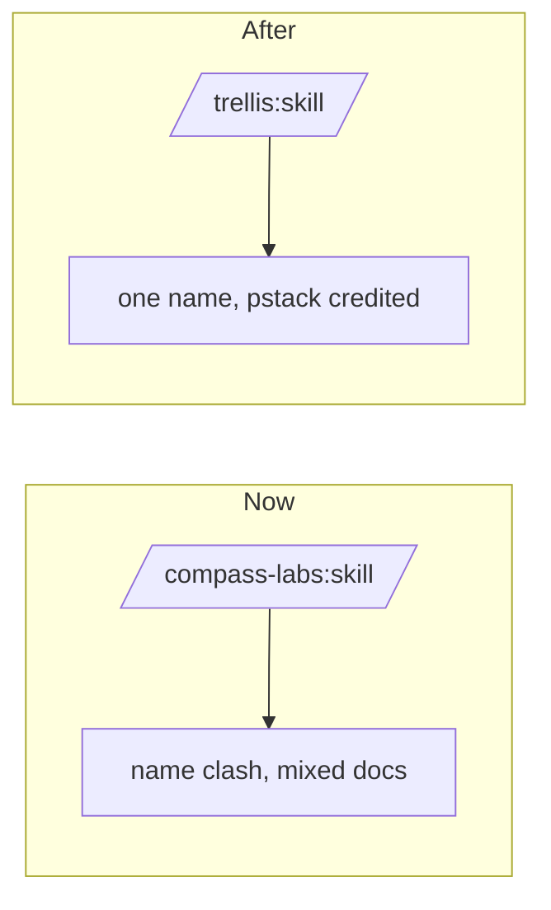

# Rename the plugin to trellis (4.0.0) and credit pstack

**Need:** The name `compass-labs` is taken elsewhere, and it is also the command prefix every user types. [issue]
**Who:** Anyone installing or invoking the plugin, and the controller's own runtime names (labels, branches, config dirs, env vars). [issue]
**Why now:** 3.0 just changed what the plugin is, so a breaking rename costs least now. Docs also mix `/compass:` and `/compass-labs:`, and that drift grows with each release. [issue]

**Success check:**
- `claude plugin validate .` passes and lists `trellis:` skills only; `bash tests/run.sh` passes.
- `grep -rn "compass-labs:" skills hooks tests .claude-plugin README.md CLAUDE.md` returns nothing, and the README has a Credits section naming pstack and its MIT license.

**Out of scope:** Rewriting `docs/sessions/`, `docs/archive/` and ADR files; renaming the GitHub repo (the maintainer does that after merge); changing GitHub settings. [issue]

**Assumptions:**
- ⚠ Renaming runtime names (`COMPASS_*`, `~/.config/compass`, `compass:ready` label) breaks existing installs and the live schedule. The issue's upgrade note covers the config move, but the label on open issues and the installed cron need a manual step after merge.
- The README anchor marker `<!-- compass:anchor -->` stays, and triage accepts both marker forms. [issue]
- The `trellis:ready` label does not exist on GitHub yet, so the maintainer creates it (this run must not change GitHub settings).
- Version bumps to 4.0.0 in `plugin.json` and the marketplace entry. [issue]
