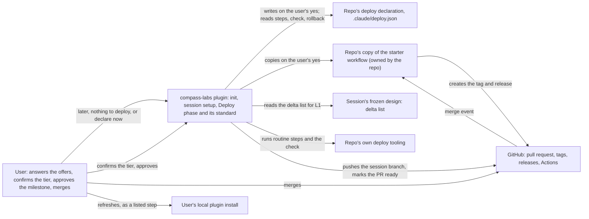
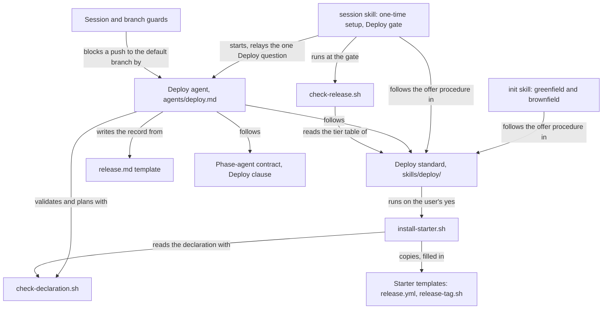
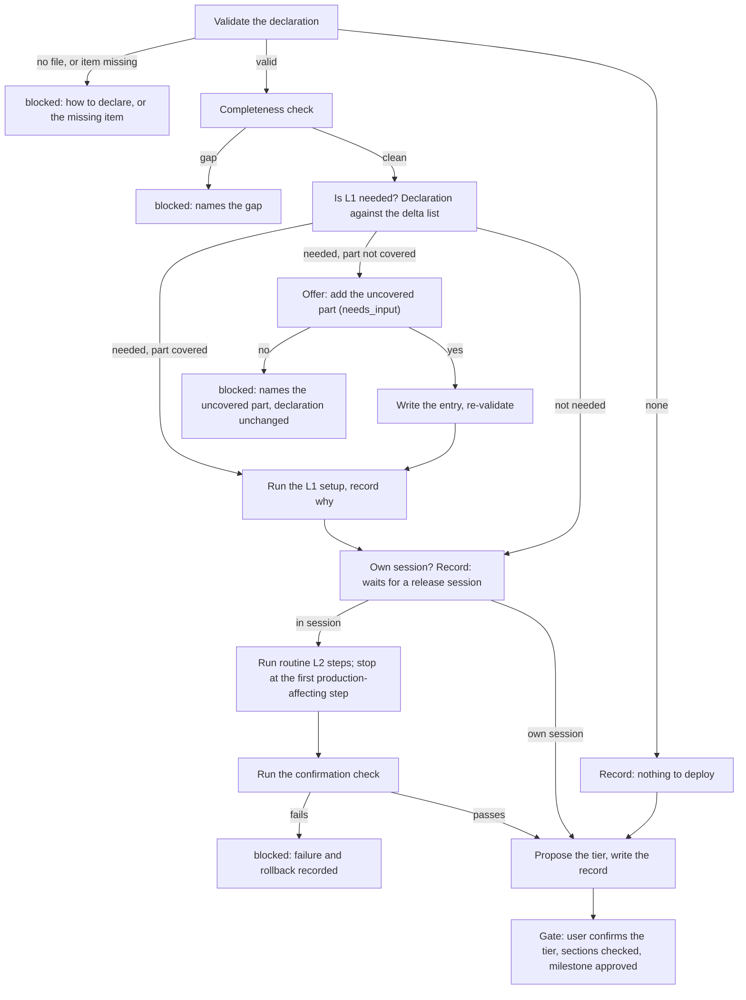
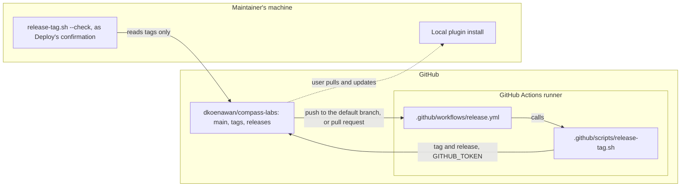

# Deploy (L3)

> → [System overview](../solution-design.md) | → Reference: [the Deploy standard](../../reference/deploy/standard.md) | → [Session overview](../session/overview.md) · [Init overview](../init/overview.md) | → Decisions: [ADR-007](../../registry/decisions/007-deploy-declaration.md) · [ADR-008](../../registry/decisions/008-deploy-runs-declared-steps.md) · [ADR-009](../../registry/decisions/009-merge-triggered-release-pipeline.md)
> Origin: #30

## What Is Deploy?

Deploy is the Feature session phase that ships a session's change, and the standard that says what shipping means for a given repo. Its primary object is the **deploy declaration**, `.claude/deploy.json`: the repo's own statement of how each deployable part is set up (L1), which steps release a session's change (L2), which of those steps are routine and which affect production, how to confirm the release worked, how to undo it, and whether a release runs inside the feature session or in its own session. Deploy reads the declaration, runs only what it allows, and writes the **release record**, `release.md`, at a depth tier that follows the release's risk.

The phase follows one standard skill, `deploy`, which the Deploy agent preloads. The same skill offers the declaration when a repo is first set up, and an optional starter GitHub Actions workflow for a repo's merge-triggered release.

### Why it exists

What "deploy" means differs per repo: for compass-labs it's a version bump, a push and a pull request; for a service it's a staging rollout, a health check and a production step that needs a human. Without a declaration, every Deploy run had to work this out again, details drifted from release to release (tag names, who bumps the version, which branch gets tagged), routine steps were left for someone to run by hand, and a consuming repo had no way to tell Deploy anything, so its Deploy either stopped or guessed. Deploy also treated every run as a release: nothing recognised that a session which adds a service, a bus or new infrastructure first needs that part's deployment set up.

### Who it's for

- **compass-labs' maintainer.** A routine plugin release (bump, commit, push, mark the pull request ready) runs with no prompts from steps declared once. After they merge, a pipeline on GitHub tags the merge commit and publishes the release; what's left for them is refreshing their local install.
- **Maintainers of consuming repos with a real deployment.** Deploy follows their declared path to staging or production and their declared check, holds every production-affecting step for their instruction, and stops with an explanation rather than guessing when nothing is declared.
- **Maintainers whose architecture changes.** When a session's design adds or changes a deployable part, Deploy recognises that its setup has to be created or updated, as its own lifecycle before the release, and offers to declare a part it doesn't know.
- **The person approving the Deploy milestone.** One record shape for every repo, at a depth that matches the release's risk: which lifecycle ran and why, the steps and their source, the confirmation, the rollback and the change record.

## How It Works

A repo gets its declaration early. When `init` scaffolds or migrates a project, and when the `session` skill first sets up a repo, the plugin offers to write one: the user can answer *later* (nothing is written, and Deploy will explain how to declare one when it gets there), *nothing to deploy* (`{"deployment": "none"}`), or *declare now*, which walks the seven items with the user in the repo's own commands and checks the file until `check-declaration.sh` calls it valid. A repo hosted on GitHub is then offered the starter workflow, which is copied only on a yes, with its version file and tag form filled in from the declaration. Initiation never runs a setup step; that stays Deploy's.

When a session reaches Deploy, the agent first validates the declaration and asks `check-declaration.sh --plan` which steps may run and which wait. No declaration, a missing item, or a merge marked routine stops it before anything runs. It then checks the release manifest for completeness, as it always has. Next it decides whether L1 is needed by reading the frozen design's delta list against the declared parts: a new or changed part the declaration lists has its setup run again; a deployable part it doesn't list prompts Deploy's one question, an offer to add that part with the drafted entry shown in full. A yes adds the entry and runs its setup; a no stops Deploy, naming the part, with the declaration unchanged.

Then L2: unless the declaration says releases run in their own session, the agent runs the routine release steps in declared order, word for word, choosing any version bump by the declared rule. The first production-affecting step, and everything after it, waits for the user's own instruction. The declared confirmation check runs over what ran; if it fails, the record shows the failure and the declared rollback and Deploy reports `blocked`. Finally the agent proposes a tier (skip, short or full, from the ITIL 4 change type the release amounts to) and writes `release.md` with the sections that tier requires.

At the **Deploy gate** the user confirms or changes the tier first, so the record is checked against the tier they agreed. The orchestrator checks completeness, then runs `check-release.sh`, which refuses a record missing a required section. After the milestone the user merges the pull request. For compass-labs, the merge triggers `.github/workflows/release.yml`: if the merge changed the plugin version, it creates the `compass-labs--v{version}` tag on the merge commit and publishes the release in one call; if not, it does nothing; if the tag already exists, it fails visibly and leaves it alone.

### Context diagram

*C4 context view of Deploy, as a Mermaid flowchart.*

*Component view of the plugin side.*

*Process flow of the Deploy phase. `blocked` stops the phase.*

*Deployment view of compass-labs' merge-triggered pipeline.*

## Core Objects / Entities

| Object | Description |
| ------ | ----------- |
| Deploy declaration | `.claude/deploy.json` in the repo: `l1.parts`, `l2.steps`, each step's `kind`, `confirmation`, `rollback`, `release_mode`, optional `versioning` and `after_merge`; or `{"deployment": "none"}`. The plugin reads it and never supplies the commands in it. |
| Deployable part | A C4 container, a service or a deployed resource, read from the frozen design's delta list. Each declared one has its L1 `setup` steps. |
| Routine / production-affecting step | A declared step Deploy may run without asking, or one that waits for the user's own instruction. A merge is always production-affecting. |
| Plan | `check-declaration.sh --plan`'s output: each step and whether it may run or waits, the release mode and the proposed tier. Deploy runs only what it lists as "may run". |
| Deploy tier | skip, short or full, from the release's risk (ITIL 4 change type), confirmed by the user at the gate. Sets which release-record sections are required. |
| Release record | `release.md`: a `Deploy tier:` line and up to seven sections. A record with no tier line is a past record. |
| Starter | `skills/deploy/templates/github/`: a workflow and a script that tag and publish on a version-changing merge and check the tag on each pull request. A repo's copy is its own. |
| Release session | A later session whose Deploy runs the declared L2 steps for every change since the last release, for a repo with `release_mode: own_session`. Defined in the standard; the session type itself is #83. |

## Code Map — Which Code Touches This

- **Standard**: `skills/deploy/SKILL.md` (lifecycles, declaration, execution rules, L1 rule, tiers, release session, frameworks, declaration offer, starter mode), `reference/declaration.md`, `reference/frameworks.md`.
- **Scripts**: `skills/deploy/scripts/check-declaration.sh` (with `lib/validate.jq` and `lib/plan.jq`), `skills/deploy/scripts/install-starter.sh`, `skills/session/scripts/check-release.sh`.
- **Starter**: `skills/deploy/templates/github/release.yml` and `release-tag.sh`.
- **Agent and contract**: `agents/deploy.md` (preloads `compass-labs:deploy`, nine steps); the Deploy clause of `skills/session/reference/phase-agent-contract.md`.
- **Record and gate**: `skills/session/templates/release.md`; the Deploy gate (a1, a2, a2b), the Deploy `needs_input` relay and one-time setup step 3 in `skills/session/SKILL.md`.
- **Initiation**: `skills/init/SKILL.md` Steps 6b (greenfield) and 8b (brownfield).
- **compass-labs' own deployment**: `.claude/deploy.json`, `.github/scripts/bump-version.sh`, `.github/workflows/release.yml`, `.github/scripts/release-tag.sh`.
- **Tests**: `tests/fixtures/deploy/` (four fixture repos and their `README.md`), and under `tests/session/`: `check_declaration_test.sh`, `check_declaration_plan_test.sh`, `check_release_test.sh`, `release_tag_test.sh`, `release_workflow_test.sh`, `install_starter_test.sh`, `own_pipeline_test.sh`, `bump_version_test.sh`, `compass_declaration_test.sh`, `deploy_standard_test.sh`, `deploy_agent_test.sh`, `deploy_contract_test.sh`, `deploy_gate_test.sh`, `deploy_offer_test.sh`, `deploy_fixtures_test.sh`, `release_template_test.sh`, `taskfile_test.sh`.

## Internal Architecture

**Declared, never derived.** Every step Deploy runs comes from the repo's declaration, word for word, and the record names the declaration as the source. Deploy never works steps out from a Taskfile or past releases, and the plugin ships no deploy tooling of its own; the starter is copied into the repo and owned there.

**Scripts decide what's mechanical; the agent keeps judgement and the record.** Whether the declaration is complete, which steps may run, the tier signal, the gate's section check, copying the starter and the tag arithmetic are all scripts. Choosing the bump level, reading "deployable part" from the delta list, drafting an uncovered part's entry, judging completeness and running the repo's commands stay with the agent. So "a production-affecting step waits" holds in code (`--plan`), not only in a prompt.

**One owner runs and records the release.** The Deploy agent runs the declared steps itself, `git` and `gh` included, so `release.md` lists what really ran and the confirmation follows the steps in the same run. The phase-agent contract's Deploy clause limits this to declared steps on the session branch, staged by name, never a merge. The branch guard still blocks any push to the default branch.

**After the merge is a pipeline, not a person.** Tagging and publishing happen on GitHub Actions, triggered by the merge, on the merge commit, with the repo's own token. Claude never pushes a tag. The same script runs before the merge as a pull-request job and as Deploy's confirmation check, so the tag a merge would create is visible in advance.

**compass-labs uses its own product.** Its pipeline is an unedited install of the starter, so the starter gets a real run on every compass-labs release.

## Dependencies

- **Internal**: the frozen `design/` folder's delta list (Design); the release-completeness check and the session orchestrator's gate; the phase-agent contract; the session branch guard and the no-merge rule; `init` and the `session` skill's one-time setup as callers of the offer.
- **External**: `jq` (`check-declaration.sh` exits 4 and checks nothing without it); `git`; `gh`, authenticated, for `gh pr ready` and `gh run list`; GitHub Actions with `GITHUB_TOKEN` able to write contents (the workflow asks for `contents: write` per job); `ssh` for resolving a host alias (`ssh -G`, config only); each consuming repo's own deploy commands.
- **Assumptions**: a release's risk can be judged from its declaration and change well enough to propose a tier, with the user confirming it; the repository host runs automation on a merge into the default branch and lists published releases; refreshing a local plugin install runs on the user's machine, out of reach of a remote pipeline.

## Gotchas

- **Claude Code treats `.claude/` as a sensitive path.** A non-interactive run (`claude -p`) refuses writes to `.claude/deploy.json` even with an explicit allow rule, so the offers that write the declaration need an interactive session where the permission prompt can be approved. A non-interactive Deploy's write of `release.md` can be refused the same way.
- **The first real pipeline run is the merge.** A pull-request run proves the workflow loads and the script runs with its settings, but the tag-and-publish job only runs on a push to the default branch. If publishing fails after a merge, no tag or release exists yet, and the same `gh release create` can be re-run by hand.
- **compass-labs' `.github/` copies aren't edited by hand.** `own_pipeline_test.sh` fails if they differ from a fresh install of the starter. Fix the template and reinstall (see [the how-to](../../how-to/update-release-pipeline-from-starter.md)).
- **A repo's starter copy doesn't follow template fixes.** Values are fixed at copy time and the copy is the repo's; changing the tag form means editing the copy, or deleting it and installing again.
- **The starter handles a JSON version field or a plain-text version file only**, and only GitHub. Other formats are the repo's own edit to its copy.
- **A revert pull request needs a new version.** Lowering the version to one already tagged makes the pipeline fail by design; tags are never overwritten.
- **"Later" isn't remembered.** A repo that answers "later" at `init` is asked again at its first session's one-time setup; only an existing declaration skips the offer.
- **The branch guard reads command text.** A declared script that pushed to the default branch itself could get past it. Declared steps use plain `git push -u origin {branch}`, and the standard forbids pushing to the default branch.
- **"Deployable part" is the agent's reading of the delta list**, not a marker. The record lists the rows read so the user can check them at the gate.
- **`task release` is gone.** Releases go through the declaration; the after-merge commands are in `.claude/deploy.json` and in `task check-upgrade`'s hint.
- **The release session type doesn't exist yet** (#83). A repo declaring `own_session` gets records that say "waits for a release session", with nothing to run that session with.
- **Per-layer and per-cloud deploy guidance is still to come**: frontend #78, backend #79, database #80, infrastructure (Terraform) #81, cloud provider references #82.

## Changelog

- 2026-11-14: Initial documentation.
