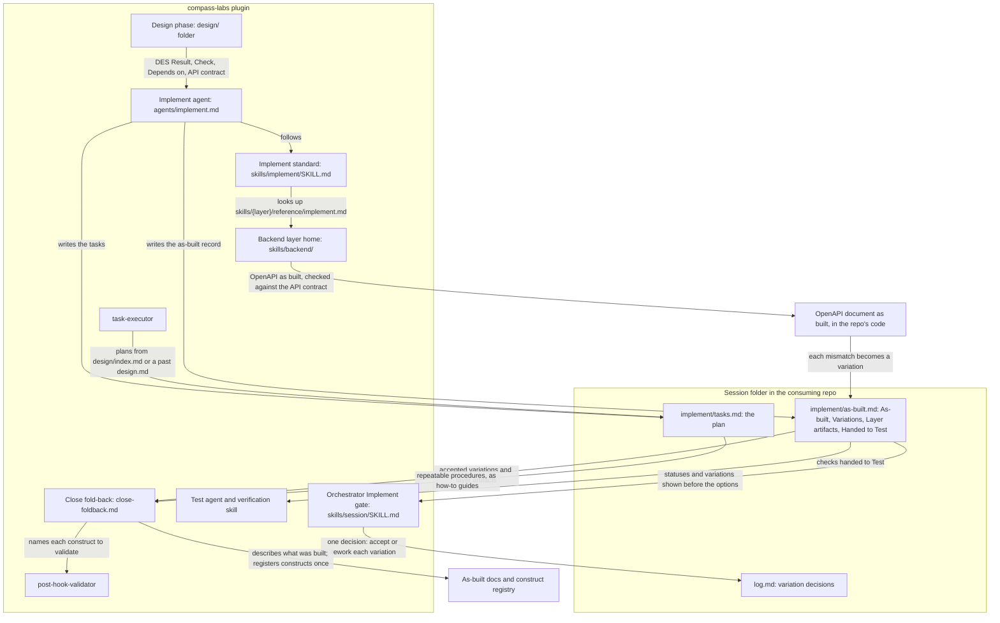

# Implement (L3)

> → [System overview](../solution-design.md) | → Reference: [the Implement standard](../../reference/implement/standard.md) | → [Session overview](../session/overview.md) · [Design overview](../design/overview.md) | → Decision: [ADR-005](../../registry/decisions/005-implement-as-built-record.md)
> Origin: #28

## What Is Implement?

Implement is the Feature session phase that turns a frozen design into working code, and into a record of what was actually built that a reviewer can check against the design. Its primary object is the **`implement/` folder**: `tasks.md`, the plan derived from the design's `DES-*` items, and `as-built.md`, the as-built record, which gives every `DES-*` item a status, lists every variation from the design, holds each layer's artifact (for the backend, the OpenAPI document as built) and hands the checks that need a Test-owned test on to Test.

The phase follows one standard skill, `implement`, and plugs in per-layer guidance from each layer's home, `skills/{layer}/reference/implement.md`. The backend is the first layer with guidance.

### Why it exists

Implement is where a design meets reality: a test shows something doesn't quite work, and the build moves away from the design. Without a record of that, a reviewer can't tell whether the build matches the design without reading the code, a built API can drift from the approved contract unnoticed, and the as-built docs, which the next session's Design reads as its only prior knowledge, go on describing a system that was never built. Without a stated testing boundary, tests get duplicated or skipped between Implement and Test, and a reviewer can't tell where a piece of evidence came from.

### Who it's for

- **The person approving the Implement milestone.** They see every `DES-*` item's status and every variation, with reasons, and decide each variation without reading the code.
- **Developers consuming a backend API.** They get a machine-readable OpenAPI description of the API as built, rendered with Scalar and compared endpoint by endpoint with the design.
- **Maintainers of the as-built docs, and later sessions.** Accepted variations are folded back by Close, so the docs describe what was built.
- **The Implement and Test agents and their reviewers.** Each kind of test has one owner, so evidence is never ambiguous.
- **compass-labs maintainers.** A later layer (frontend, database, AI-agent) plugs in by adding its own files, as its own issue.

## How It Works

The orchestrator hands the Implement phase to the Implement agent, which preloads the `implement` skill. The agent reads the frozen `design/index.md`: its Components (DES) table, where each item names its result, its check and what it depends on, and its implementation order. It writes `implement/tasks.md` as a checklist in which every task comes from one item's result, the item's check sits on its last task, and the order follows the design's dependencies. A check that needs an integration, UI or Playwright test isn't put on a task; it's handed to Test.

The agent then builds the tasks in order, one commit per ticked task. For each item it reads the guidance of the layer the item names, if that layer has any. It writes unit and component tests only. When the build differs from the design (a different response shape, an endpoint that couldn't be built, an extra one that had to be), it records a variation in `as-built.md` there and then, and never touches the frozen design. For a backend item that changes an HTTP API, it builds in the repository's established stack, commits an OpenAPI document of the API as built, renders it with Scalar, and compares it with the design's API contract one row per designed endpoint; every mismatch becomes a variation. A layer with no guidance is still built, and the gap is recorded and tied to that layer's follow-up issue.

At the **Implement gate** the orchestrator shows every item's status and every variation before the approve, adjust and rethink options, and asks the user to accept each variation as built or send it back for rework. The outcomes are logged as one decision. Rework changes the code, never the design, and the gate repeats until nothing is outstanding, so every variation in the frozen record is one the user accepted.

**Test** then verifies each requirement with at least one test it owns (integration, UI, Playwright or inspection), covering the checks Implement handed over. Implement's unit and component tests appear only as supporting evidence. At **Close**, accepted variations become the built behaviour in the reference docs, layer artifacts become reference pointers (the OpenAPI document's path, for the backend), and Close registers the constructs the session built in the registry, once, after every variation has been decided.

### Context diagram

*C4 component view of the Implement path across the plugin, as a Mermaid flowchart.*

## Core Objects / Entities

| Object | Description |
| ------ | ----------- |
| `implement/` folder | Implement's one artifact: `tasks.md` and `as-built.md`, owned by `compass-labs:implement` and frozen as a unit at the Implement milestone. A past session has a root `tasks.md` instead. |
| Task | One checklist line in `implement/tasks.md`, derived from one `DES-*` Result, naming it as `[DES-nnn]`. One commit per ticked task. |
| As-built status | Exactly one of *built as designed*, *built with variation* or *not built* per `DES-*` item, with a reason for anything but the first. |
| Variation | A difference between the design and the build: the item, what was designed, what was built and why. Decided at the Implement gate; IDs are local to `as-built.md`. |
| Layer artifact | What a layer's guidance says to record. For the backend: the OpenAPI document as built, its Scalar result, and the endpoint-by-endpoint API check. |
| Handed to Test | The `DES-*` checks that need a Test-owned test, which Implement never writes. |
| Layer home | `skills/{layer}/`, holding the layer's `reference/implement.md` (and `reference/design.md` once written). Found by path, never by a list. |
| Test-owned method | `integration`, `ui`, `playwright` or `inspection`: the only Methods a `VER-*` row uses. Implement's tests are cited as "Supporting:" evidence. |

## Code Map — Which Code Touches This

- **Standard**: `skills/implement/SKILL.md` covers tasks, the testing boundary, the as-built record, the layer plug-in contract, the missing-guidance fallback and past sessions.
- **Layer guidance**: `skills/backend/SKILL.md` and `skills/backend/reference/implement.md` (stack, tests, OpenAPI with Scalar, the API check). It links `skills/design/reference/stack-defaults.md` rather than restating defaults.
- **Artifact shape**: `skills/session/templates/implement/` (`tasks.md`, `as-built.md`) and the `implement/` entry in `skills/session/workflows/feature.json` (`artifact_files`, `legacy_artifact: "tasks.md"`). The root `templates/tasks.md` stays for past sessions.
- **Agent**: `agents/implement.md` preloads `compass-labs:implement` and writes only `implement/` (or a past session's root `tasks.md`) and code.
- **Gate**: the Implement gate in `skills/session/SKILL.md`.
- **Consumers**: `agents/test.md` and `skills/verification/SKILL.md` read Handed to Test and the As-built section; `skills/session/reference/close-foldback.md` folds `implement/` back; `skills/task-executor/` plans and executes the same checklist format; `skills/task-executor/scripts/find-active-plan.sh` finds a plan in either layout; `skills/doc-maintainer/SKILL.md` checks fold-back eligibility in either layout.
- **Tests**: `tests/session/implement_standard_test.sh`, `tests/session/find_active_plan_test.sh`, and the `implement/` cases in `tests/hooks/session_guard_test.sh` and `tests/session/workflow_test.sh`.

## Internal Architecture

**Plan and record are separate files.** `select-next-task.sh` parses every checklist line in the plan file, so the as-built record lives in its own file and holds tables only. Nothing in it can be read as a task.

**The record is per `DES-*` item, not per task.** Statuses and variations name the design's items, so the reviewer compares like with like, and Close can fold a variation into the docs without session IDs.

**Variations go forward, never upstream.** Implement records a difference; it never edits `define/` or `design/`. The gate decides it, and Close carries the accepted result into the as-built docs. The frozen design stays as the record of what was approved.

**Layers plug in by path.** The standard looks up `skills/{layer}/reference/implement.md` from the layer named in a `DES-*` item's Component cell. It names no layers, so a new layer is files plus a marketplace listing.

**The testing boundary is held by instruction.** `check-traceability.sh` still only checks that every live requirement has a passing `VER-*` row. The Test standard requires a Test-owned method on every row and keeps Implement's tests to the Evidence cell, so a supporting citation can't satisfy the gate on its own.

**One construct registrar.** `task-executor` reads the registry but never writes it. Close registers what a session built once its variations are decided, and `post-hook-validator` validates each construct by name afterwards.

## Dependencies

- **Internal**: the frozen `design/` folder and its `DES-*` table (Design); the session orchestrator's gate; the guard hook (folder ownership and freezing); the `verification` standard (Test); Close's fold-back; `task-executor`'s checklist format and scripts; `stack-defaults.md` for established-stack signals.
- **External**: Scalar's CLI, run through `npx` for the render check (needs Node.js and network; otherwise the result is recorded as *not rendered*); the consuming repo's own test runner.
- **Assumptions**: a backend that serves an HTTP API can produce or hold an OpenAPI 3.x document in its own stack's way; the design's API contract names method, path, request, response and error cases precisely enough to compare against; the repository has a test command Implement can detect.

## Gotchas

- **Only the backend has Implement guidance.** Frontend (#57), database (#58), AI-agent (#59) and infrastructure (#50) items are built by the fallback, and their As-built rows cite those issues. A non-OpenAPI backend API (GraphQL, gRPC) also uses the fallback (#60).
- **The API check is agent-run, not mechanical.** One row per designed endpoint makes an omission visible at the gate, but a missed mismatch depends on the agent and the reviewer. Spec-first OpenAPI from Design is #47.
- **Never write a checklist line in `as-built.md`.** The template is tables only for that reason.
- **A session has one layout.** A new session can't create a root `tasks.md`, and a past one can't create `implement/`. Past sessions keep a "Deviations from design" section, which Close folds like accepted variations.
- **`post-hook-validator` runs after Close.** The registry isn't current during the build; a construct is `built` only once Close registers it.
- **`task-executor`'s `scripts/run.sh` still mentions the retired `overview.md`.** Nothing calls it; its removal is #64.
- **The session log template's Artifacts line still links a root `tasks.md`.** Tracked in #65.

## Changelog

- 2026-10-17: Initial documentation.
