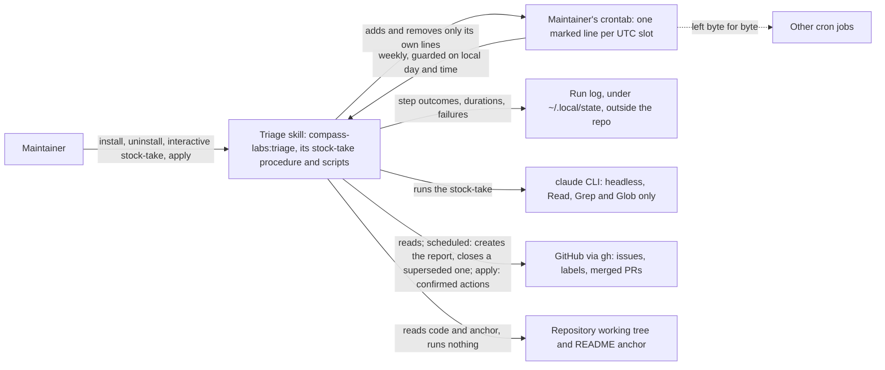
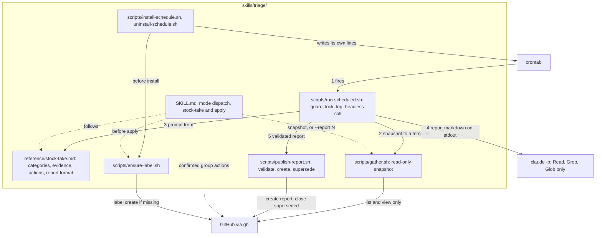

# Triage (L3)

> → [System overview](../solution-design.md) | → Reference: [modes, report, schedule and limits](../../reference/triage/stock-take-and-schedule.md) | → Decision: [ADR-010](../../registry/decisions/010-read-only-scheduled-triage-run.md) | → Usage: [README, Backlog Triage](../../../README.md#backlog-triage)
> Origin: #86

## What Is Triage?

Triage is the supporting skill that keeps a repository's open GitHub issues in line with the project's current direction. Its primary object is the **stock-take**: one pass over every open issue. Each issue gets exactly one of six categories, the code lines or merged pull requests the category rests on, the project anchor lines it bears on, its cluster and blocked-by relations, and the action that category calls for.

A stock-take only ever *proposes*. The maintainer runs it interactively, or a weekly scheduled run publishes it as a **report issue**, `Triage YYYY-MM-DD`. Nothing else changes until the maintainer **applies** it, confirming one category group at a time.

### Why it exists

Every Feature session defers a handful of follow-ups to new issues, so the backlog grows with each session. Some of those issues are then covered by merged work, made obsolete by a change of direction, or duplicated. Agents that read issues to frame a session take stale text at face value, and the maintainer picks the next work from a backlog that no longer reflects the project. Catching this by hand means reading every issue and checking its claims against the code and merged PRs, which doesn't happen unless someone remembers to do it. Triage makes that check weekly and unattended, and leaves every change to the maintainer's approval (the anchor's non-goal "Replacing user approval at milestones").

### Who it's for

- **The compass-labs maintainer.** A report is waiting every week without them starting it, and they review and confirm each group of changes before anything on GitHub changes.
- **Anyone reading an open issue**, including the orchestrator framing a new session. After an apply, every open issue carries a `**Triage (YYYY-MM-DD):**` comment that says how it maps to the anchor and what it duplicates, belongs with or is blocked by.
- **Maintainers of other repositories using compass-labs.** They install the schedule at their own local day, time and time zone. A repository without a project anchor still gets a full stock-take, without the anchor mapping and with a recommendation to create one.

## How It Works

The maintainer installs the schedule once, for example `install --day sat --time 01:00 --tz Pacific/Auckland`. The installer checks `gh` is signed in, refuses if the repository already has a schedule, and creates the `triage` label. Cron runs in UTC and can't follow a time zone, so the installer works out every UTC slot that local time falls on across a year of daylight-saving changes. It writes one marked crontab line for each, two for Auckland. Each line records the absolute paths of `claude` and `gh`, because cron's `PATH` is minimal.

When a line fires, `run-scheduled.sh` first checks the local weekday and time in the installed zone and quietly exits if this slot isn't the right one. Otherwise it takes a lock, logs to a per-repository folder under `~/.local/state`, outside the repository, and checks its binaries and `gh auth status`. `gather.sh` then takes a read-only snapshot into a temporary folder: open issues with comments, open reports, recent merged PRs with their changed files, the README's anchor and some metadata. A headless `claude -p` follows the stock-take procedure over the snapshot and the working tree. It can use only Read, Grep and Glob, loads no settings, plugins, hooks or MCP servers, and prints the report. `publish-report.sh` checks that the report covers every snapshot issue exactly once in the fixed format. If it does, the script creates the report issue and closes any earlier report that was never applied, as superseded. If anything fails, the log says why, nothing is published, and an invalid report is kept beside the log for inspection.

The maintainer reads the report and runs `apply #N` in their own Claude Code session. The apply re-reads the report and flags every issue that changed since it was published, re-checking those before their group comes up. It then asks once per category group. A yes runs that group's `gh` actions (close, fold a cluster into its main issue, retitle, comment); a no leaves those issues untouched. At the end, each issue still open gets its triage comment, and the report is closed with the list of groups applied and declined, so the next scheduled run doesn't supersede it. The same procedure also runs interactively with no report at all: a bare `/compass-labs:triage` shows the proposed actions and changes nothing, and `apply` then carries them out.

### Context diagram

*C4 context view of triage, as a Mermaid flowchart.*

*Component view. Solid edges are the scheduled run, dashed edges the interactive modes.*

## Core Objects / Entities

| Object | Description |
| ------ | ----------- |
| Stock-take | One pass over every open issue, except report issues: one category, evidence, anchor lines, relations and a proposed action per issue. Defined once in `reference/stock-take.md` |
| Category | Exactly one of *covered by merged work*, *direction changed*, *duplicate or cluster*, *rewrite or narrow*, *still relevant*, *needs a user decision*. Each has one action |
| Cluster | Issues asking for the same thing or parts of one change, with one main issue the others fold into |
| Snapshot | The temporary folder `gather.sh` writes: `issues.json`, `reports.json`, `merged-prs.json`, `anchor.md`, `meta.json`, and `changed.json` for a named report |
| Report issue | `Triage YYYY-MM-DD` by the authenticated `gh` user, labelled `triage` when the label exists. Unapplied while open |
| Apply | An interactive run that carries out a stock-take's actions, one confirmed category group at a time |
| Schedule | The repository's marked crontab lines, one per UTC slot, all removed together by uninstall |
| Run log | `{local-date}.log` per run, with an invalid report kept as `{local-date}.report.md`, under `${XDG_STATE_HOME:-$HOME/.local/state}/compass-labs/triage/{repo-slug}/` |

## Code Map — Which Code Touches This

- **Skill and procedure**: `skills/triage/SKILL.md` (modes, confirmation rule, apply actions, test runs) and `skills/triage/reference/stock-take.md` (rule zero, inputs, procedure, categories, report format).
- **Scripts**: `skills/triage/scripts/gather.sh`, `publish-report.sh`, `run-scheduled.sh`, `install-schedule.sh`, `uninstall-schedule.sh`, `ensure-label.sh`. See the [reference](../../reference/triage/stock-take-and-schedule.md#scripts).
- **Packaging**: `.claude-plugin/marketplace.json` lists `./skills/triage`, and the README's Backlog Triage section documents usage.
- **Tests**: `tests/triage/` (ten `*_test.sh` files), with its own stub `gh`, `crontab` and `claude` in `tests/triage/stubs/` and helpers in `tests/triage/lib.sh`. The shared `tests/lib.sh` isn't used. `isolation_test.sh` checks that no test touches a real binary, crontab or log.
- **Registry**: [TriageSkill](../../reference/constructs/TriageSkill.md), [StockTakeProcedure](../../reference/constructs/StockTakeProcedure.md), [TriageSnapshot](../../reference/constructs/TriageSnapshot.md), [TriageReportPublisher](../../reference/constructs/TriageReportPublisher.md), [TriageScheduledRun](../../reference/constructs/TriageScheduledRun.md), [TriageSchedule](../../reference/constructs/TriageSchedule.md), [TriageLabel](../../reference/constructs/TriageLabel.md).

## Internal Architecture

**An unattended model reads; scripts write.** In a scheduled run the model has no tool that acts. Every GitHub call is made by `gather.sh` (reads only) or `publish-report.sh` (one create and the superseding closes), so text in an issue that tries to steer the run can't act. See [ADR-010](../../registry/decisions/010-read-only-scheduled-triage-run.md).

**Validate before any write.** The report format's headings are the exact strings `publish-report.sh` checks. A report that misses an issue, adds one, or breaks the structure is never published, so there is no partial report.

**One procedure for every mode.** `stock-take.md` is written to work both as the skill's reference and, unchanged, as the headless prompt, so interactive and scheduled stock-takes can't drift apart.

**Time zones by mapping plus a guard.** The installer writes every UTC slot the local time can fall on, and the runner checks the local day and time. This handles any zone, including half-hour offsets, with at most two wake-ups a week.

**Report identity by title and author.** A report is recognised by its title pattern *and* the authenticated user as author, not by the label. A look-alike issue by someone else is never excluded, superseded or applied, and reports still work when the label is missing.

**Skills stay independent.** Triage calls `gh issue comment` directly rather than reusing `task-executor`'s wrapper, and logs outside the repository rather than to `<repo>/logs/` like `doc-maintainer` and `task-executor`, so a run leaves `git status` unchanged.

## Dependencies

- **Internal**: the project anchor contract (`skills/framing/reference/anchor-contract.md`) for the `<!-- compass:anchor -->` markers. `/compass-labs:framing` is what the report recommends when no anchor exists.
- **External**: GitHub through the `gh` CLI (issues, labels, merged PRs, `api user`); the `claude` CLI and its `--restricted`, `--tools` and `--strict-mcp-config` flags; cron and the machine's time-zone database; `jq`, `git` and coreutils `timeout`.
- **Assumptions**: the machine is on and online at the scheduled time, and a missed run isn't caught up. `gh` is signed in with permission to create, comment on and close issues and to create labels. A report for up to 100 issues fits in one issue body. `gh` and `claude` have stored credentials that cron can see.

## Gotchas

- **Interactive apply needs `AskUserQuestion`.** It accepts no other confirmation, so it can't be driven from a headless `claude -p` session. It stops before the first group and makes no change.
- **Evidence comes from the checked-out branch.** A scheduled run reads whatever the working tree has checked out, which may be a feature branch rather than the default branch. The report header records the branch and HEAD it read.
- **Credentials must be stored, not exported.** Cron doesn't see variables exported only in a shell profile, such as `GH_TOKEN`. A `claude` sign-in that expires between runs makes the run fail at the stock-take step (see #92 for the recommended `claude setup-token`).
- **A schedule installed before 2026-11-14 holds a versioned `claude` path.** Older installers resolved symlinks, so their cron lines point into `~/.local/share/claude/versions/{version}`, which an auto-update removes, and runs then fail at preflight naming `TRIAGE_CLAUDE_BIN`. The installer now keeps the path as found (for example the `~/.local/bin/claude` symlink). To pick that up, run `uninstall-schedule.sh <repo>`, then `install-schedule.sh <repo> --day … --time … --tz …` once with the same day, time and zone.
- **A daylight-saving gap skips a week.** A local time that doesn't exist on a spring-forward day doesn't run that week. The installer warns about it.
- **Large reports aren't published.** If many long issues push the report past 65,536 characters, the run logs the failure and publishes nothing (#90).
- **Reports from another account aren't recognised.** If the scheduled run and the apply use different `gh` accounts, the apply refuses `apply #N`, and the next scheduled run won't supersede that report.
- **Open work**: #88 (scheduled runs closing issues covered by a merged PR without an apply), #89 (plugin/tooling Implement guidance), #90, #92.

## Changelog

- 2026-11-14: Initial documentation.
- 2026-11-14: The installer keeps symlinked binary paths unresolved, and a scheduled report's header Run date is the run's local date (#91, #93).
