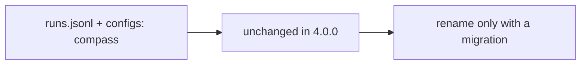

# Kept the internal run role "compass" and the compass_repo key

- Old run logs, configs and findings typed `compass` are still read.
- Renaming would silently drop history, so it is deferred.
- Revisit with a migration if the leftover name confuses readers.

Evidence: docs/trails/2026-11-26-34-rename-the-plugin-to-trellis.tsv rows 3–4
