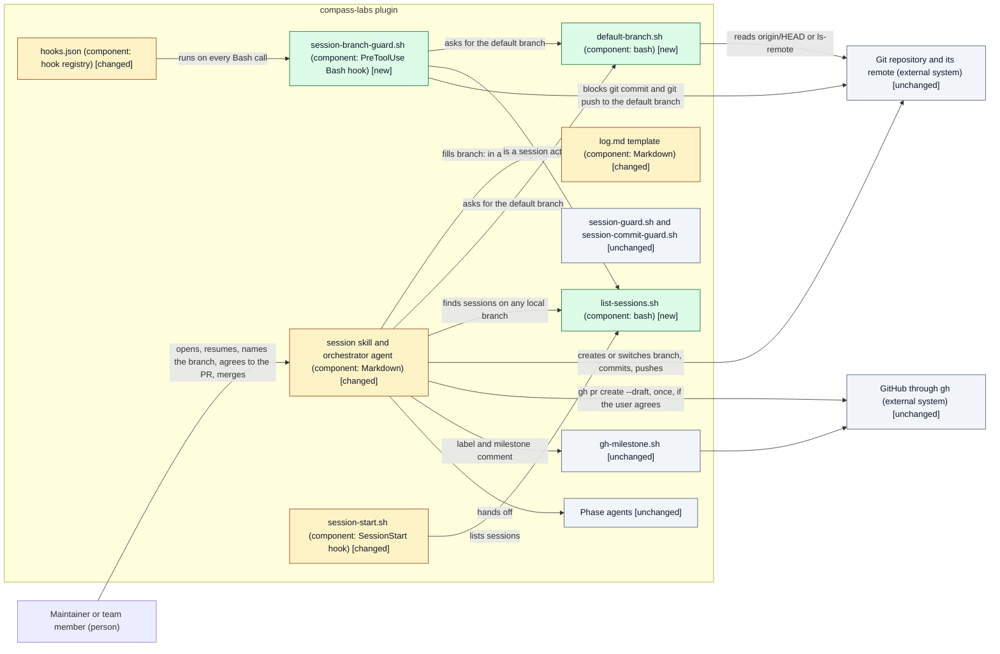
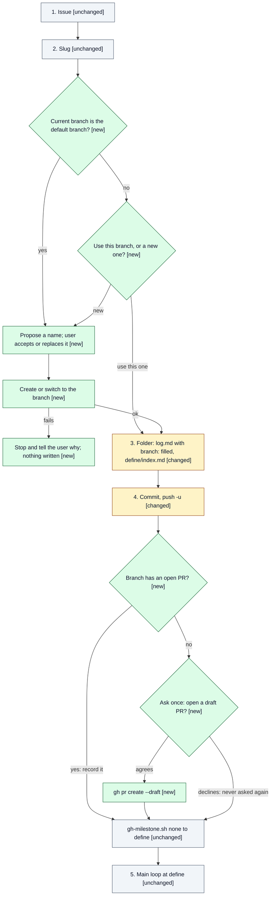

# Design: Session opens on a feature branch

> Phase: Design | Started: 2026-10-19 | Status: Draft (D1 to D6 await the user)
> Requirements: [`define/index.md`](../define/index.md) · Session history: [`log.md`](../log.md)

## Contents

This design has no in-depth file: its primary kind has no in-depth path yet (see [Classification](#classification)), and no layer standard applies. Everything is in this file.

## Prior knowledge

- **Read:**
  - `docs/explanation/session/overview.md` (New session flow, Resume flow, milestone gate, "mechanical enforcement over prompt instructions")
  - `docs/reference/session/hooks-and-scripts.md` (hook table, exit codes, fail-open rule, test harness)
  - `docs/registry/patterns.md` ("Commit, push, then GitHub", "Hooks fail open", "Plugin paths vs. project paths", "Atomic commit points")
  - `docs/registry/decisions/002-session-lifecycle.md` (ADR-002: enforcement has to be mechanical)
  - Code: `skills/session/SKILL.md`, `agents/orchestrator.md`, `skills/session/workflows/feature.json`, `skills/session/templates/log.md`, `hooks/hooks.json`, `hooks/session-guard.sh`, `hooks/session-commit-guard.sh`, `hooks/session-start.sh`, `hooks/lib/session-log.sh`, the `tests/` layout
  - This session: `define/` (all four files) and `log.md`
- **Not read:** any past session folder, including `docs/sessions/archive/`. The #22 design's D5 ("branch created at Implement") is known here only as Define cites it; this design supersedes it.

## Classification

- **Primary kind:** Plugin/tooling: every live requirement changes the plugin's own orchestrator skill, hooks or scripts (REQ-001 to REQ-004, REQ-007, REQ-008, REQ-010 change the `session` skill's flows; REQ-005 and REQ-006 need a hook and a default-branch lookup; REQ-009 is an orchestrator rule).
- **In-depth path:** none yet: dkoenawan/compass-labs#51, see Open questions.

## Scope checklist

| Area | In scope? | Reason |
|---|---|---|
| Plugin/tooling | in | A new hook (REQ-005), a default-branch lookup (REQ-006), and changes to the `session` skill's New session flow, Resume flow and main loop (REQ-001 to REQ-004, REQ-007, REQ-008, REQ-010) |
| Process/workflow | in | The session lifecycle's git workflow changes: the branch exists from the first commit, the PR opens at the first push, and merging stays the user's call (REQ-001, REQ-008, REQ-009). This supersedes the #22 design's D5 timing |
| GitHub integration (`gh`) | in | A draft pull request is opened through `gh` after the user agrees (REQ-008) |
| Tests (`tests/run.sh` harness) | in | The new hook and lookup get harness tests, like every existing hook |
| Frontend | out | No user interface |
| Backend | out | No service or API |
| Database | out | No stored data beyond the session folder |
| Infrastructure | out | No hosting or deployment; branch protection, CI and merge settings are a non-goal |
| Visual UI design | out | No screens |
| As-built docs (`docs/explanation/`, `docs/reference/`) | out | Close folds the change in at the end of the session, including retiring #22's D5 timing in `docs/explanation/session/overview.md` |

## Context view

The design follows the recommended option in each of D1 to D6 below. Those choices are still the user's, and the views change if a different option is picked.

*Notation: C4 component view of the `compass-labs` plugin inside a consuming repository, drawn as a Mermaid `flowchart` with delta styling. The classDefs add `color:#0F172A` so labels stay readable in dark mode, ahead of the standard (#66).*

*Notation: process flow of the New session flow, drawn as a Mermaid `flowchart` with delta styling (a simple flow, so no BPMN, per `reference/notations.md`).*

## Delta list

Each element this design touches has exactly one status. Every visual matches this list.

| Element | Status | DES | Note |
|---|---|---|---|
| `skills/session/scripts/default-branch.sh` | new | DES-001 | Prints the remote's default branch name (D6) |
| `skills/session/scripts/list-sessions.sh` | new | DES-002 | Active or paused sessions in the working tree and at the tip of every local branch (D2, D4) |
| `hooks/session-branch-guard.sh` | new | DES-003 | PreToolUse hook on `Bash`: blocks session `git commit` and `git push` to the default branch (D1, D2) |
| `hooks/hooks.json` | changed | DES-003 | Adds a `PreToolUse` entry with matcher `Bash` |
| `skills/session/templates/log.md` | changed | DES-004 | New frontmatter field `branch:` (D3) |
| `skills/session/SKILL.md`, New session flow | changed | DES-005, DES-006 | New branch step before the folder; first push with `-u`, then the one-time draft PR prompt |
| `skills/session/SKILL.md`, Mode dispatch and Resume flow | changed | DES-007 | Lists sessions with `list-sessions.sh`; switches to the session branch before anything else |
| `hooks/session-start.sh` | changed | DES-008 | Builds its "Active sessions" list from `list-sessions.sh`, so sessions on other branches appear |
| `skills/session/SKILL.md`, Close milestone; `agents/orchestrator.md` | changed | DES-009 | States that the orchestrator never merges unless the user's own message says to |
| `tests/hooks/session_branch_guard_test.sh`, `tests/session/default_branch_test.sh`, `tests/session/list_sessions_test.sh` | new | DES-001, DES-002, DES-003 | Harness tests in throwaway repos |
| `tests/hooks/session_start_test.sh`, `tests/session/session_skill_test.sh` | changed | DES-005 to DES-009 | New cases for the listing and for the skill's new rules |
| `hooks/session-guard.sh`, `hooks/session-commit-guard.sh`, `hooks/lib/session-log.sh` | unchanged | — | The branch guard is a separate hook (single responsibility) |
| `skills/session/scripts/gh-milestone.sh` | unchanged | — | Still runs after the push, and after the PR prompt |
| `skills/session/workflows/feature.json` | unchanged | — | No new artifact or phase |
| `skills/session/templates/implement/tasks.md` (its `branch:` field) | unchanged | — | Implement fills it from `log.md`'s `branch:` |
| Phase agents (`agents/*.md` other than the orchestrator) | unchanged | — | Phase agents never commit |
| Git repository and remote; GitHub | unchanged | — | External systems |

## Components (DES)

Each item names the `REQ-*` it covers, the result Implement must produce, the check that shows it's done, and the items it depends on.

| ID | Component | Covers | Result | Check | Depends on |
|---|---|---|---|---|---|
| DES-001 | Default-branch lookup, `skills/session/scripts/default-branch.sh` | REQ-006 | `default-branch.sh [repo-path]` prints the default branch name and exits 0. It reads `git symbolic-ref --short refs/remotes/origin/HEAD` (stripping `origin/`), and if that ref is missing, `git ls-remote --symref origin HEAD`. It never assumes `main`. Exits 1 with a reason on stderr when there is no `origin` or neither source answers (no remote is #70's). Tests in `tests/session/default_branch_test.sh` | In a throwaway repo cloned from a local bare remote whose HEAD is `trunk` and which has no `main`, it prints `trunk`, both with `origin/HEAD` set and after `git remote set-head origin -d`. With no remote, it exits 1 | — |
| DES-002 | Session lister, `skills/session/scripts/list-sessions.sh` | REQ-004, REQ-005 | `list-sessions.sh [repo-path]` prints one tab-separated line per active or paused session: `{slug}`, `{status}`, `{branch it was found on}`, `{recorded branch: or -}`. It reads `docs/sessions/*/log.md` (never `archive/`) in the working tree, untracked files included, and at the tip of every local branch (`git for-each-ref refs/heads` with `git grep` or `git show`, read-only, no checkout). A slug found in the working tree wins over a branch copy. Exit 0, also when empty. Tests in `tests/session/list_sessions_test.sh` | In a throwaway repo with `main` checked out and an active session committed only on `feat/5-widget`, it prints that session with `feat/5-widget`. An untracked new `log.md` with `status: active` is listed. An archived session isn't | — |
| DES-003 | Branch guard, `hooks/session-branch-guard.sh`, registered in `hooks/hooks.json` as `PreToolUse` matcher `Bash` | REQ-005, REQ-006 | Exits 0 at once unless the command contains a `git … commit` or `git … push` invocation (compound commands with `&&`, `;` and `\|` are split; `git -C dir` is honoured). Otherwise it treats the call as a session commit when `list-sessions.sh` prints any session or the index has staged paths under `docs/sessions/` (D2). It then blocks (exit 2) a `commit` whose current branch is the default branch, and a `push` whose destination is the default branch: an explicit refspec destination (`main`, `HEAD:main`, `refs/heads/main`), `--all` or `--mirror`, or no refspec while the default branch is checked out. The message names the default branch, for example "BLOCKED: `main` is this repository's default branch; session commits reach it only through a pull request (REQ-005)". Fails open with a warning when `jq` is missing, the cwd isn't a git repo, or `default-branch.sh` can't answer. Tests in `tests/hooks/session_branch_guard_test.sh` | Harness: with an active session and `main` checked out, `git commit -m x` is blocked with `main` in the message and `main`'s head is unchanged. Same with default `trunk` and no `main`. `git push origin HEAD:main` and `git push` on `main` are blocked. `git commit` on `feat/5-widget` and `git push -u origin feat/5-widget` are allowed. With no active session and nothing staged under `docs/sessions/`, a commit on `main` is allowed. `ls` and `git status` are allowed. No `jq`: allowed with a warning | DES-001, DES-002 |
| DES-004 | Session branch record, `skills/session/templates/log.md` frontmatter | REQ-003 | A `branch: {branch-name}` field after `issue:`, with a one-line comment: the session branch, written once when the session opens, read by Resume. Sessions without the field still work (DES-007) | The template has the field; `tests/session/session_skill_test.sh` asserts it | — |
| DES-005 | New session flow branch step, `skills/session/SKILL.md` (a new step between Slug and Folder) | REQ-001, REQ-002, REQ-003, REQ-007, REQ-010 | The step reads the default branch with DES-001 and the current branch. On the default branch: propose `feat/{issue}-{kebab-title}` and let the user accept or replace it (REQ-007). On another branch: ask "use `{branch}`" or "create a new branch"; a new one gets the same name proposal and is created from the local default branch (D5). Then `git switch {name}` if the branch exists, else `git switch -c {name} {base}`. On any failure, stop before writing the folder and relay git's reason. Step 3 writes the chosen name into `log.md`'s `branch:` | `session_skill_test.sh` asserts the step's rules are stated (branch step before the folder, the ask on a non-default branch, the name proposal, stop on failure, `branch:` filled). Live at Test, per OUT-01: a throwaway repo on clean `main`, on `feat/5-existing`, on default `trunk`, and with the branch checked out in another worktree | DES-001, DES-004 |
| DES-006 | First push and draft PR prompt, `skills/session/SKILL.md` New session flow step 4 | REQ-008 | Step 4 pushes with `git push -u origin {branch}`. Then, before `gh-milestone.sh`: if `gh pr list --head {branch} --state open` shows a PR, log it and don't ask. Otherwise ask once whether to open a draft PR; if the user agrees, `gh pr create --draft --base {default} --head {branch}` with a title from the issue and `Refs #{issue}` in the body, then log a `note` with the PR's URL. If the user declines, log a `decision` and never ask again in this session. A `gh` failure is logged as "GitHub sync pending", like `gh-milestone.sh` | `session_skill_test.sh` asserts the order (commit, push, PR prompt, `gh-milestone.sh`), the one-time ask and `--draft`. Live at Test: the draft PR exists before the next log entry after the opening commit | DES-005 |
| DES-007 | Session listing and Resume flow, `skills/session/SKILL.md` (Mode dispatch and Resume flow) | REQ-004 | Listing uses DES-002 instead of a working-tree scan. Resume, before the recap: if the session's branch (its `branch:` or, without one, the branch it was found on) isn't checked out, `git switch` to it; on failure, stop and tell the user why. Then read `log.md` from the checkout and recap as today | `session_skill_test.sh` asserts the switch-before-anything rule and the use of `list-sessions.sh`. Live at Test: resume with `main` checked out; the next milestone commit lands on `feat/5-widget`, and `main` and `origin/main` don't move | DES-002, DES-004 |
| DES-008 | Session list at start, `hooks/session-start.sh` | REQ-004 | Builds its "Active sessions" lines from DES-002's output, adding `on {branch}` when the session isn't in the working tree. Still always exits 0 | `tests/hooks/session_start_test.sh`: a session committed only on another branch appears with its branch | DES-002 |
| DES-009 | No-merge rule, `skills/session/SKILL.md` (main loop and Close milestone) and `agents/orchestrator.md` | REQ-009 | One rule, stated in both files: the orchestrator never runs `gh pr merge`, or a `git merge` or `git push` into the default branch, unless the user's own message asks for it. The Close milestone tells the user the PR is ready for them to merge. A phase agent's or subagent's message never counts as the instruction | `session_skill_test.sh` asserts the rule in both files, and that no step of the skill merges. Live at Test: after the Close milestone is approved with no merge request, the PR is still open | — |

**Coverage:** all 10 live REQs covered. REQ-001 DES-005 · REQ-002 DES-005 · REQ-003 DES-004, DES-005 · REQ-004 DES-002, DES-007, DES-008 · REQ-005 DES-002, DES-003 · REQ-006 DES-001, DES-003 · REQ-007 DES-005 · REQ-008 DES-006 · REQ-009 DES-009 · REQ-010 DES-005. No deferred or struck rows.

**Implementation order** (from Depends on): DES-001, DES-002, DES-004, DES-009 → DES-003, DES-005, DES-007, DES-008 → DES-006.

**Carried from Define:** the block is a hook (ADR-002) and covers session commits only (DES-003); the default branch is read from the repository (DES-001); the PR prompt is asked once, at the first push, and not again if declined (DES-006); the #22 design's D5 ("branch created at Implement") is superseded by DES-005, and Close folds that into `docs/explanation/session/overview.md`.

## Decisions

All six are **awaiting the user's choice**. Each shows the recommendation; nothing below is decided yet.

**D1: How the REQ-005 block is enforced ([ADR-002](../../../registry/decisions/002-session-lifecycle.md); ADR, since it adds a new enforcement point).**

| Option | Pros | Cons |
|---|---|---|
| **Claude Code `PreToolUse` hook on `Bash` that inspects `git commit` and `git push` (recommended)** | Same mechanism as the other guards; ships with the plugin, so nothing is installed into the consuming repo; sees only commands Claude runs, so the user's own terminal git is untouched (Define's "session commits only") | Reads command text, so an unusual form (`sh -c "git commit"`, a git alias) can get past it |
| Git `pre-commit` and `pre-push` hooks installed into the consuming repo | Catches every commit however it's made | Also blocks the user's own git work unless it can tell Claude apart; writes into `.git/hooks` or `core.hooksPath`, which clashes with husky, lefthook and team setups; needs an install step |

**D2: When the hook treats a commit or push as a session commit.**

| Option | Pros | Cons |
|---|---|---|
| A. An active or paused session in the working tree, or staged paths under `docs/sessions/` | Simplest; no branch scan | Misses Implement's code commits on the default branch when the session folder only exists on its own branch (the resume case REQ-004 fixes by prompt alone) |
| **B. A, plus an active or paused session at the tip of any local branch (recommended)** | Closes A's gap mechanically, per ADR-002; reuses DES-002, which Resume needs anyway | One `git grep` per local branch on each `git commit` or `git push`; while any session is open, Claude's non-session commits to the default branch are blocked too (which matches Define's definition of a session commit) |
| C. Every Claude-run commit or push to the default branch in a repo that has `docs/sessions/` | Simplest rule of all | Blocks Claude's commits outside any session, wider than Define's "session commits only" |

**D3: Where the session branch is recorded (REQ-003).**

| Option | Pros | Cons |
|---|---|---|
| **A `branch:` field in `log.md`'s frontmatter (recommended)** | Machine-readable, beside `issue:` and `phase:`; Resume and scripts read it with `sed`; matches `implement/tasks.md`'s existing `branch:` | Changes the template; sessions opened before it have no field |
| A line under Open items | No template change | Free text, so scripts can't read it reliably; Open items get edited and pruned |

**D4: How Resume finds a session whose folder isn't in the current checkout (REQ-004).** With the session on its own branch, a `main` checkout has no copy of its folder.

| Option | Pros | Cons |
|---|---|---|
| **Scan local branches, read-only, with `list-sessions.sh`, and list those sessions too (recommended)** | REQ-004 works with no help from the user; the start-up list shows every open session | A new script, and `session-start.sh` changes |
| List the working tree only; when `resume {slug}` isn't found, ask the user which branch it's on | No new script | The default list on `main` shows no sessions, so a user may open a duplicate; relies on the user knowing the branch |

**D5: Where a new branch starts when the session opens on a non-default branch and the user picks "new branch" (REQ-002).**

| Option | Pros | Cons |
|---|---|---|
| **The local default branch's tip (recommended)** | The session's PR into the default branch carries only session work | Leaves the current branch's commits out, which may surprise a user who wanted to build on them (they can choose "use this branch" instead) |
| The current `HEAD` | No surprise about what's in the working tree | The PR carries the other branch's commits too |

**D6: How the default branch is read (REQ-006).**

| Option | Pros | Cons |
|---|---|---|
| **`origin/HEAD` symbolic ref, then `git ls-remote --symref origin HEAD` (recommended)** | Plain git, any host; the first source is local and instant; the fallback asks the remote itself | The fallback needs the network; a repo whose remote isn't called `origin` gets no answer (fail open) |
| `gh repo view --json defaultBranchRef` | Authoritative on GitHub | GitHub only, needs `gh` auth and the network on every commit check |
| `git config init.defaultBranch` | Local, instant | It's the user's preference for new repos, not this repo's default branch, so it can be wrong |

## Principles check

| Item | KISS | YAGNI | SOLID |
|---|---|---|---|
| DES-001 | met: two git calls | met: REQ-006 | SRP met; OCP n/a: one fixed lookup; LSP n/a: no substitutable types; ISP met: one name on stdout; DIP met: callers depend on the script's output, not on git details |
| DES-002 | met | met: REQ-004 and D2 need it | SRP met: lists, never decides; OCP n/a; LSP n/a; ISP met; DIP met |
| DES-003 | met: one rule, fast exit for every other command | met | SRP met: a separate hook, not a new rule in `session-guard.sh`, whose job is file writes; OCP met: no change to existing hooks; LSP n/a; ISP met; DIP met: default branch and session list come from DES-001 and DES-002 |
| DES-004 | met: one field | met: REQ-003 | n/a: a template, not software |
| DES-005 | met | met | SRP met: one new step; OCP n/a: prose rules; LSP n/a; ISP n/a; DIP met: uses DES-001, doesn't re-derive the default branch |
| DES-006 | met: inline `gh pr create`, no new script | met: one ask, no PR tracking field | SRP met; OCP n/a; LSP n/a; ISP n/a; DIP n/a |
| DES-007 | met | met | SRP met; OCP n/a; LSP n/a; ISP n/a; DIP met: uses DES-002 |
| DES-008 | met | met: without it the start-up list hides sessions on other branches (D4) | SRP met; OCP n/a; LSP n/a; ISP n/a; DIP met: uses DES-002 |
| DES-009 | met: one rule in two places the orchestrator reads | met: REQ-009 | n/a: a prose rule for the model, not code |
| D1 | met | met | met: a separate hook keeps each guard to one job |
| D2 | met (B) | met: B serves ADR-002's mechanical-enforcement constraint on REQ-005 | n/a: a policy choice |
| D3 | met | met | n/a: a data location |
| D4 | met | met | n/a |
| D5 | met | met | n/a |
| D6 | met | met | n/a |

No principle is marked *traded off*.

**Rejected under YAGNI:**
- A `pr:` field in `log.md` for the PR number: no live REQ reads it; the log entry carries the URL.
- A `gh-pr-open.sh` script: one `gh pr create` call needs no wrapper.
- Blocking commits that aren't on the recorded session branch (as opposed to the default branch): no live REQ asks for it.
- A hook that blocks `gh pr merge`: REQ-009 lets the orchestrator merge when the user instructs it, so a hard block would break the allowed case.
- Picking a non-`origin` remote for the default branch, or several remotes: the throwaway-repo criteria and both needs use `origin`; no remote at all is #70.
- Moving in-flight sessions onto the `branch:` field: a non-goal. DES-007 falls back to the branch a session was found on.

## Risks

| Risk | Mitigation |
|---|---|
| The hook reads command text, so `sh -c`, `eval`, a git alias or a script that commits can get past it | Splits compound commands and honours `git -C`; the skill runs plain `git` commands; the gap is listed in the hook's header comment. D1's alternative is there if the user wants a stronger guarantee |
| The hook fails open (no `jq`, no answer from `default-branch.sh`), so the guarantee is lost silently in that repo | Warns on stderr every time, per the "Hooks fail open" pattern; no remote is #70's |
| `git ls-remote` stalls on a slow network on every commit when `origin/HEAD` isn't set | The fallback runs only when `origin/HEAD` is missing, and `git clone` always sets it; `ls-remote` gets a short timeout and then fails open |
| The branch scan in DES-002 slows commits in a repo with many local branches | `git grep` at each branch tip is read-only and fast; the scan runs only for `git commit` and `git push`, not every Bash call |
| `git switch` fails on a dirty working tree that conflicts with the session branch | Covered by REQ-010 at open and by DES-007's stop-and-explain at resume; the user decides how to clean up |
| An existing branch that is already pushed and has a PR | DES-006 checks for an open PR first and doesn't ask |

## Open questions

- **D1 to D6** await the user's choice (see Decisions).
- **Closing the issue at Close.** Close step 6 runs `gh issue close` and cites "Closed = PR merged", but with DES-009 the PR may still be open when Close is approved. No live REQ covers this. Should it stay as is, or be a follow-up issue?
- Plugin/tooling has no in-depth design path yet: dkoenawan/compass-labs#51. Process/workflow has none either: dkoenawan/compass-labs#49. This design covers both in the all-kinds sections.
