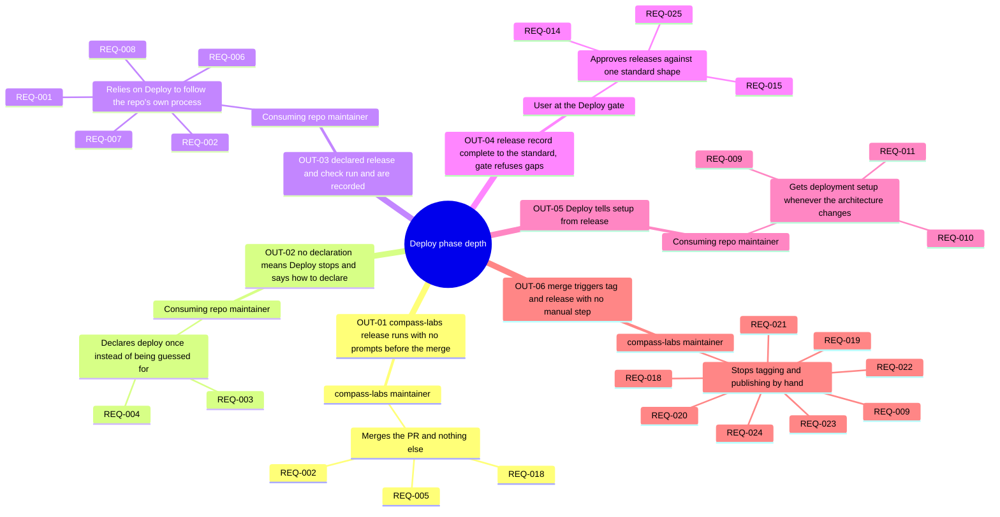
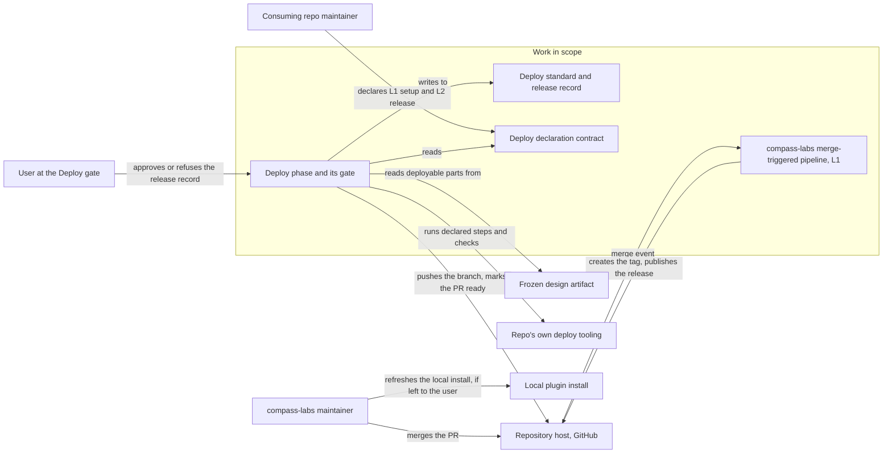
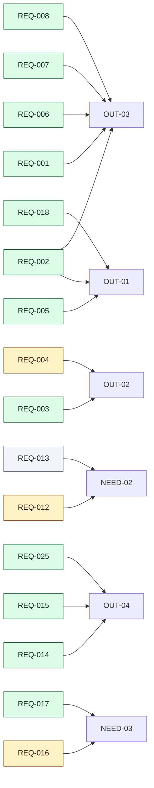
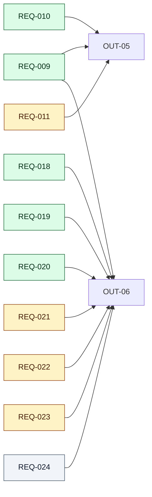

<!-- tier: full. Follows the rendering rules in skills/requirements/reference/diagrams.md. -->
# Diagrams: Deploy phase depth

> Part of [index](index.md) · Define

## Impact map

## Context diagram

## Traceability

Split per group of outcomes so it can be reviewed. Colour shows priority. `NEED-nn` appears only where a requirement serves a need alone.

REQ-001 also serves NEED-02, REQ-006 and REQ-023 also serve NEED-01, and REQ-008 and REQ-025 also serve NEED-03. Those needs are already reached through their outcomes, so the links aren't drawn.

## As-is and to-be

The Deploy process for a compass-labs release, as recorded in the five archived release records, and as it will be.

```mermaid
flowchart TD
  classDef changed fill:#FEF3C7,stroke:#92400E,color:#451A03
  classDef new fill:#DCFCE7,stroke:#166534,color:#052E16
  classDef removed fill:#FEE2E2,stroke:#991B1B,color:#450A0A
  subgraph ASIS["As-is"]
    A1["S1 agent works out what deploy means for this repo"] --> A2["S2 completeness check"]
    A2 --> A3["S3 agent runs some steps, lists the rest as pending"]
    A3 --> A4["S4 user or orchestrator bumps, pushes, readies the PR"]
    A4 --> A5["S5 user merges"]
    A5 --> A6["S6 user tags main and publishes by hand"]
    A6 --> A7["S7 user refreshes the local install"]
  end
  subgraph TOBE["To-be"]
    B1["S1 Deploy reads the repo's declaration"]:::changed --> B2["S2 completeness check"]
    B2 --> B8["S8 Deploy decides whether L1 is needed and runs it first"]:::new
    B8 --> B3["S3 routine L2 steps run with no prompts"]:::changed
    B3 --> B9["S9 declared confirmation check, Deploy tier proposed, record checked by the gate against that tier"]:::new
    B9 --> B5["S5 user merges"]
    B5 --> B6["S6 merge-triggered pipeline tags main and publishes"]:::changed
    B6 --> B7["S7 local install refresh, user step unless Design moves it"]
  end
  class A4 removed
```

S4 is removed: the separate hand-run bump, push and PR-ready steps become part of S3's routine steps.
