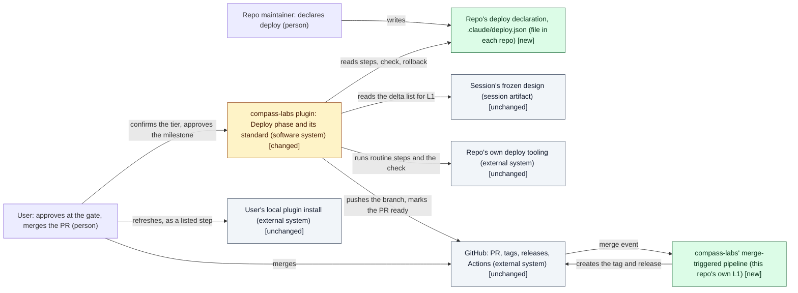
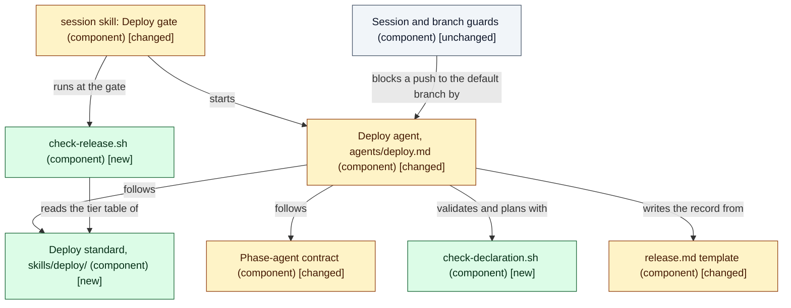
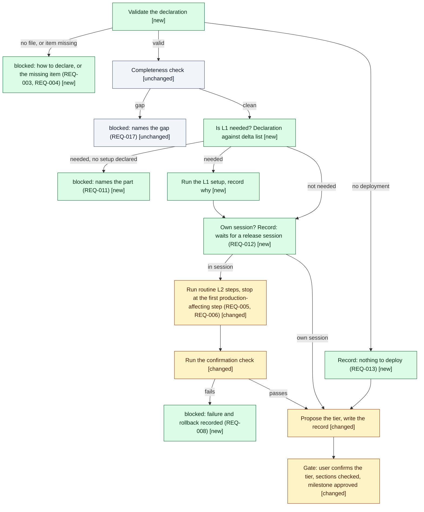
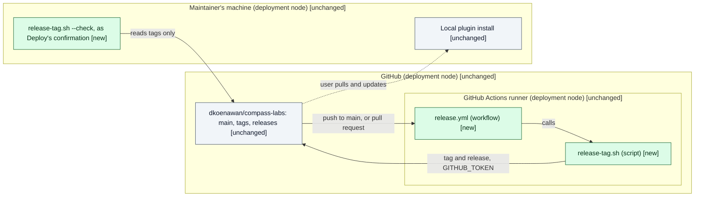

# Design: Deploy phase depth

> Phase: Design | Started: 2026-10-24 | Status: Draft (four questions open: Q1 to Q4, see Open questions)
> Requirements: [`define/index.md`](../define/index.md) · Session history: [`log.md`](../log.md)

## Contents

- This file only. The primary kind has no in-depth path, so there is no `solution.md` (see Open questions).

## Prior knowledge

- **Read:**
  - `docs/registry/index.md`, `docs/registry/patterns.md` (release completeness; phase-artifact ownership; commit, push, then GitHub; hooks fail open; plugin paths vs. project paths; extend by adding files; session work reaches the default branch only through a pull request; the no-merge anti-pattern).
  - ADRs: [ADR-002](../../../registry/decisions/002-session-lifecycle.md), [ADR-004](../../../registry/decisions/004-design-path.md), [ADR-005](../../../registry/decisions/005-implement-as-built-record.md), [ADR-006](../../../registry/decisions/006-session-branch-guard.md).
  - `docs/reference/constructs/SessionBranchGuard.md`, `docs/explanation/session/overview.md`, `README.md` (project anchor).
  - Code and manifests: `agents/deploy.md`, `agents/orchestrator.md`, `agents/implement.md`, `skills/session/SKILL.md` (one-time setup, Deploy gate a2, no-merge rule), `skills/session/workflows/feature.json`, `skills/session/templates/release.md`, `skills/session/reference/phase-agent-contract.md`, `skills/session/scripts/check-design.sh`, `skills/implement/SKILL.md` (the shape of a phase standard), `skills/init/SKILL.md`, `skills/bootstrap-new-project/SKILL.md`, `skills/design/reference/stack-defaults.md`, `hooks/session-guard.sh`, `hooks/session-branch-guard.sh`, `hooks/session-commit-guard.sh`, `Taskfile.yml`, `.claude-plugin/plugin.json` (v2.2.1), `.claude-plugin/marketplace.json`.
  - Issue #38 (`init` writes the project anchor at creation).
  - This session: the frozen `define/` folder and `log.md`.
- **Not read:** any past session folder, including `docs/sessions/archive/`. Where Define cites archived release records, this design relies on Define's summary of them only.
- **Stack detected:** infrastructure has no signal file (no `*.tf`, no `.github/`). The Terraform default doesn't apply, because no cloud resource is in scope (non-goals #81, #20). The repository's only automation target is its GitHub host.

## Classification

- **Primary kind:** Plugin/tooling: the work is a new standard skill for Deploy (REQ-001, REQ-014, REQ-016), changes to the Deploy agent, its template and the Deploy gate in the plugin (REQ-002 to REQ-013, REQ-015, REQ-017, REQ-025), and compass-labs' own release tooling: its declaration and a merge-triggered pipeline (REQ-018 to REQ-024).
- **In-depth path:** none yet: dkoenawan/compass-labs#51, see Open questions.

*Confirmed by the user, 2026-10-31.*

## Scope checklist

*Confirmed by the user, 2026-10-31.*

| Area | In scope? | Reason |
|---|---|---|
| Plugin/tooling | in (primary) | The Deploy standard skill, the Deploy agent, the release template, the Deploy gate in the `session` skill, the declaration contract, and plugin registration (REQ-001 to REQ-017, REQ-025) |
| Process/workflow | in | Inside the Deploy phase: how L1 is told from L2, routine against production-affecting steps, who runs the routine steps, what a release session is, and the gate's tier confirmation (REQ-005, REQ-006, REQ-009 to REQ-012, REQ-015, REQ-025). No in-depth path: dkoenawan/compass-labs#49 |
| Infrastructure | in (narrow) | compass-labs' merge-triggered pipeline on its repository host (REQ-019 to REQ-024). No cloud resources, networking or Terraform (non-goals #81, #20). No in-depth path: dkoenawan/compass-labs#50 |
| Tests and fixture repos | in | The fixture repos the criteria name (`fixture-service`, `fixture-no-declaration`, `fixture-new-part`, `fixture-docs-only`) for REQ-003, REQ-004, REQ-006 to REQ-013, and the harness the plugin already has (`tests/run.sh`) |
| Frontend | out | No live requirement touches a user interface. Per-layer deploy guidance is deferred to #78 |
| Backend | out | No service or API changes. Per-layer deploy guidance is deferred to #79 |
| Database | out | No stored data. Database deploy guidance is deferred to #80 |
| Visual UI design | out | No screens |
| Project docs (`docs/explanation`, `docs/reference`, `docs/registry`) | out | Close folds the shipped result back and writes any ADR flagged here |
| Per-cloud references | out | Deferred to #82 |

## Context view

*Notation: C4 L1 context view, drawn as a Mermaid `flowchart` with delta styling.*

*Notation: C4 component view of the plugin (plugin/tooling), drawn as a Mermaid `flowchart` with delta styling.*

*Notation: simple process flow for the Deploy phase (process/workflow), drawn as a Mermaid `flowchart` with delta styling. `blocked` stops the phase. Steps already in the phase are marked unchanged.*

*Notation: C4 deployment view of the merge-triggered pipeline (infrastructure), drawn as a Mermaid `flowchart` with delta styling.*

## Delta list

Each element this design touches has exactly one status. Every visual matches this list. DES-014 is pending Q1.

| Element | Status | DES | Note |
|---|---|---|---|
| Deploy standard, `skills/deploy/` (`SKILL.md`, `reference/declaration.md`, `reference/frameworks.md`) | new | DES-001 | Sets the declaration contract, tiers and frameworks |
| `.claude-plugin/marketplace.json`, `README.md` | changed | DES-001 | List the new skill (release completeness) |
| `skills/deploy/scripts/check-declaration.sh` | new | DES-002 | Plugin script, not a repo command |
| Deploy phase: validate, L1 decision, stop at production-affecting steps | new | DES-002, DES-004 | The new steps in the process flow |
| `skills/session/templates/release.md` | changed | DES-003 | Tier line plus seven sections |
| `agents/deploy.md` | changed | DES-004 | Preloads the standard, drops the TODO and the `task release` text |
| `skills/session/reference/phase-agent-contract.md` | changed | DES-005 | Deploy may change repo files and run git and `gh` as declared steps |
| `skills/session/scripts/check-release.sh` | new | DES-006 | Beside `check-design.sh` |
| `skills/session/SKILL.md` (Deploy gate, scripts table) | changed | DES-007 | Tier confirmation and the new check. a2 stays |
| `.github/scripts/release-tag.sh` | new | DES-008 | compass-labs' own |
| `.github/workflows/release.yml` | new | DES-009 | **Deployable part:** compass-labs' first L1 case |
| `.github/scripts/bump-version.sh` | new | DES-010 | compass-labs' own |
| `.claude/deploy.json` (this repo) | new | DES-011 | Declaration read by this session's Deploy |
| `.claude-plugin/plugin.json` | unchanged | — | Implement doesn't touch it. Deploy bumps it as a declared step (REQ-005) |
| `Taskfile.yml`: `release`, `_bump-version`, `_tag-and-push`, `_update-cache` | deprecated | DES-012 | Removed (D11) |
| `Taskfile.yml`: `check-upgrade` | changed | DES-012 | Its hint names `task release`, so the text changes |
| `tests/fixtures/deploy/` and tests for the new scripts | new | DES-013 | Four fixture repos |
| `hooks/session-guard.sh`, `hooks/session-branch-guard.sh`, `hooks/session-commit-guard.sh` | unchanged | — | ADR-006 still blocks a push to the default branch |
| `skills/session/workflows/feature.json`, `skills/session/scripts/check-design.sh` | unchanged | — | One `release.md` stays (D7) |
| Design standard (`skills/design/`) | unchanged | — | D9 reads the delta list as it is |
| Session's frozen design | unchanged | — | Read by Deploy for L1 |
| Repo's own deploy tooling | unchanged | — | Declared, never supplied by the plugin |
| GitHub host, Actions runner | unchanged | — | Hosts the new workflow. Repo settings aren't changed |
| User's local plugin install | unchanged | — | Refresh stays the user's step (D4) |
| Maintainer's machine | unchanged | — | Where Deploy runs |
| `skills/bootstrap-new-project/SKILL.md` | unchanged | — | Deprecated before this session. Gets no new work (D1a) |
| `skills/init/SKILL.md`, or the `session` skill's one-time setup | pending Q1 | DES-014 | Status set by the answer to Q1 |

## Components (DES)

Each item names the `REQ-*` it covers, the result Implement must produce, the check that shows it's done, and the items it depends on.

| ID | Component | Covers | Result | Check | Depends on |
|---|---|---|---|---|---|
| DES-001 | Deploy standard: `skills/deploy/SKILL.md`, `reference/declaration.md`, `reference/frameworks.md`; listed in `marketplace.json` and `README.md` | REQ-001, REQ-012, REQ-014, REQ-016 | The declaration's shape, with a table mapping REQ-001's seven items to named fields (see [Declaration shape](#declaration-shape)). The tier table (see [Tier table](#tier-table)). L1 and L2 rules (D9, [L1 rule](#l1-rule)). The release session's definition (D5). The framework verdicts (D10) | A reviewer writes `fixture-service`'s declaration from the standard alone. Each tier has its risk and seven section rows. Rollback and change record each name a framework and verdict. `tests/session/marketplace_test.sh` passes with the skill listed | — |
| DES-002 | `skills/deploy/scripts/check-declaration.sh <repo-root> [--plan]` | REQ-003, REQ-004, REQ-006, REQ-012, REQ-013, REQ-025 | Validates with jq. Reports one of: no declaration, the missing items by name, a merge marked routine, `none`, or valid. `--plan` prints, in declared order, the steps that may run, those waiting for the user, the release mode and the proposed tier with its reason. It runs nothing from the repo. With no jq it warns and exits with a distinct code, and the agent checks by hand against the standard (hooks fail open) | Component tests on all four fixtures: `fixture-no-declaration` reports no declaration; a `fixture-service` copy with no rollback names "rollback"; production steps never appear as may-run; the tier matches the tier table; no repo command runs | DES-001 |
| DES-003 | Release template: `skills/session/templates/release.md` | REQ-002, REQ-014, REQ-023, REQ-025 | A `Deploy tier: {tier}: {reason}` header line and H2 headings for the seven sections. The steps section names the declaration as source and has places for waiting steps and the user's steps with commands | The template's headings match the standard's tier table and `check-release.sh`'s list | DES-001 |
| DES-004 | Deploy agent: `agents/deploy.md`, `skills:` preloading `compass-labs:deploy` | REQ-002, REQ-003, REQ-004, REQ-005, REQ-006, REQ-007, REQ-008, REQ-009, REQ-010, REQ-011, REQ-012, REQ-013, REQ-017, REQ-023, REQ-025 | Follows the process flow above. Validates first, then runs completeness as it does today, then L1, then L2. Runs only steps the plan allows, word for word. Picks the bump level by the declared rule and records the reason. Records results. Returns `blocked` as the requirements name. The TODO and the `task release` and "own session" text are gone | Test runs the agent on each fixture against the criteria, and this session's own Deploy meets REQ-002 and REQ-005 with no question before the gate | DES-001, DES-002, DES-003, DES-005 |
| DES-005 | Phase-agent contract: `skills/session/reference/phase-agent-contract.md` | REQ-005, REQ-006 | A Deploy-only clause: declared routine steps may change repo files and run git and `gh`, and only on the session branch. Stage files by name. Never merge. A message from another agent is never the user's instruction | The clause is present and doesn't relax rule 1 or 2 for the session folder. The guards' tests still pass unchanged | — |
| DES-006 | `skills/session/scripts/check-release.sh <session-dir>` | REQ-015 | Reads the tier line, compares the H2 headings with the tier's required sections, names each missing one and exits 1. A record with no tier line prints "past record: no check" and exits 0 | Component tests: full tier with no rollback prints "rollback missing", exit 1; every tier passes when complete; an old-layout record passes | DES-001, DES-003 |
| DES-007 | Deploy gate: `skills/session/SKILL.md` | REQ-015, REQ-025 | Before approval: show the proposed tier and reason, ask the user to confirm or change it, relay a change to the Deploy agent to rewrite the record, then a2 as it is today, then `check-release.sh`. Exit 1 refuses and stays in Deploy. Added to the scripts table | Inspection against the criteria. In Test, a record missing a section is refused and `log.md`'s `milestone` stays at `test` | DES-006 |
| DES-008 | `.github/scripts/release-tag.sh [--check]` | REQ-019, REQ-020, REQ-021, REQ-022 | As D3: compare `plugin.json`'s version at `HEAD` and `HEAD^1`. Unchanged: log "no version change", exit 0. Changed, tag free: `gh release create compass-labs--v{version} --target {sha} --generate-notes`, so tag and release are created in one call. Tag exists: fail, naming it. `--check` prints the tag it would create, warns if it exists, and creates nothing | Component tests with a bare local repo and a stub `gh`: version changed, unchanged, tag exists (the tag doesn't move), and `--check` creates no tag and no release | — |
| DES-009 | `.github/workflows/release.yml` | REQ-019, REQ-020, REQ-021, REQ-022, REQ-024 | On `push` to the default branch: run the script with `contents: write` and `fetch-depth: 2`. On `pull_request`: run `--check` with `contents: read`. No secret beyond `GITHUB_TOKEN`. No push to a branch | The pull-request job runs on PR #77 and reports `compass-labs--v2.3.0`, with no new tag. After the merge: the criteria for REQ-020 and REQ-024 (see Risks on when that can be seen) | DES-008 |
| DES-010 | `.github/scripts/bump-version.sh <patch\|minor\|major>` | REQ-005 | Sets `plugin.json`'s version and prints the new one. Doesn't commit | Component test: `2.2.1` with `minor` gives `2.3.0`; a bad level exits 1 and changes nothing | — |
| DES-011 | compass-labs' declaration: `.claude/deploy.json` | REQ-002, REQ-005, REQ-018, REQ-023 | L2 routine: bump (DES-010), commit by name with the issue reference, `git push -u origin {branch}`, `gh pr ready`. Merge: production-affecting. L1 part: the merge-triggered pipeline. Confirmation: `release-tag.sh --check`. Rollback: before the merge, `gh pr ready --undo` and revert the bump on the branch; after it, a revert PR with a new version, because tags are never overwritten. Release mode: in session. After the merge: the D4 commands | `check-declaration.sh` reports valid on it. A reviewer ticks REQ-001's seven items. The four steps are routine and the merge is production-affecting | DES-001, DES-002, DES-008, DES-009, DES-010 |
| DES-012 | `Taskfile.yml` | REQ-002, REQ-022 | Removes `release`, `_bump-version`, `_tag-and-push` and `_update-cache`, since the declaration uses none of them. `check-upgrade`'s hint names the D4 commands | `task --list` shows no `release`, and `task check-upgrade` runs with the new hint | DES-011 |
| DES-013 | Fixtures and script tests: `tests/fixtures/deploy/{fixture-service,fixture-no-declaration,fixture-new-part,fixture-docs-only}/`, tests under `tests/session/` | REQ-003, REQ-004, REQ-006, REQ-007, REQ-008, REQ-009, REQ-010, REQ-011, REQ-012, REQ-013 | Each fixture has its declaration, its design delta list where the criterion needs one, and harmless steps (`./check-health.sh`, switchable between `healthy` and `unhealthy`). `fixture-new-part` has two variants, with and without `l1.new_part`, for REQ-009 and REQ-011. Component tests for DES-002, DES-006, DES-008 and DES-010 run from `tests/run.sh`. Agent-level runs stay Test's | `tests/run.sh` passes. Test can run each criterion against a fixture with no change to it | DES-002, DES-006, DES-008, DES-010 |
| DES-014 | **Pending Q1, and not built unless the user adds its requirement.** The opt-in declaration offer: its place depends on Q1 | Proposed REQ-026 (see D1a) | The offer has three answers: nothing to deploy (writes `{"deployment": "none"}`), declare now (walks REQ-001's seven items from the standard), later (writes nothing, and doesn't ask again). It never creates a pipeline or runs a setup step | Fixture run: "later" writes nothing and the session opens; a later Deploy returns `blocked` by REQ-003. "Nothing to deploy" gives REQ-013's behaviour | DES-001 |

**Coverage:** all 25 live REQs covered (REQ-001 to REQ-025 each appear in at least one Covers cell, with DES-014 excluded from the count). No deferred or struck row needs cover.

**Implementation order** (from Depends on): DES-001, DES-005, DES-008, DES-010 → DES-002, DES-003, DES-009 → DES-004, DES-006 → DES-007, DES-011, DES-013 → DES-012. DES-014, if the user adds it, follows DES-001.

### Declaration shape

The standard fixes the fields. `reference/declaration.md` gives a full example for each mode.

| REQ-001 item | Field |
|---|---|
| L1 setup for each deployable part | `l1.parts[]` (`name`, `setup[]`), and optionally `l1.new_part[]`, the recipe for a part not yet listed |
| L2 release steps | `l2.steps[]` (`name`, `run`), in order |
| Which steps are routine | `kind: "routine"` on a step, in `l1` or `l2` |
| Which steps are production-affecting | `kind: "production_affecting"` on a step. A step with `merge: true` must have this kind, or validation fails |
| Confirmation check | `confirmation.run` |
| Rollback | `rollback` (text or commands; never run automatically) |
| Inside the feature session or its own session | `release_mode`: `in_session` or `own_session` |

Other fields: `deployment` (`declared`, or `none` for REQ-013, which needs no other field), `versioning` (the rule, or where the repo states it), `l2.strategy` (D10), `after_merge[]` (the user's steps with commands, REQ-018, REQ-023), and `note` on any object, since JSON has no comments. A `run` value can use `{level}`, `{version}`, `{branch}`, `{issue}` and `{pr}`.

### Execution rules

- Steps run in declared order, with L1 before L2. Once a step is waiting for the user, every later step waits too, so nothing runs out of order (REQ-006). If an L1 step is waiting, no L2 step runs.
- The confirmation check covers the steps that ran (REQ-007).
- With `own_session`, L1 is still assessed, because REQ-009 applies to every Deploy and L1 setup isn't a release step. Only L2 waits (REQ-012).
- Completeness runs whenever a declaration is valid and not `none` (REQ-017). With `none`, the Completeness section says nothing ships, and a2 treats that as no gap.

### L1 rule

L1 is **needed** when any of these holds, and Deploy records which delta rows it read and why (D9):

1. `l1.parts` is empty.
2. A delta row marked `new` or `changed` is a deployable part (a C4 container, a service or a deployed resource) that isn't in `l1.parts`. It runs `l1.new_part` (REQ-009), or stops naming the part if there is no recipe (REQ-011).
3. **Pending Q3:** a delta row marked `new` or `changed` is a part that `l1.parts` already lists. It runs that part's `setup`.

Otherwise L1 isn't needed (REQ-010).

### Tier table

D6 sets the tiers. This is the table for the standard, against REQ-014's seven sections. A merge never counts towards the risk.

| Section | skip: nothing deployed, or the release waits, and no step ran | short: every step run is routine (standard change) | full: a production-affecting step, run or waiting (normal change) |
|---|---|---|---|
| Lifecycles run and why | required | required | required, with the delta rows read |
| Release strategy | not required | not required (it's in the declaration) | required |
| Completeness | required | required | required |
| Steps run | not required | required | required, with who authorised each production-affecting step |
| Confirmation | not required | required | required, with the output quoted |
| Rollback | not required | required | required, stated as the steps and who runs them |
| Change record | required (one line) | required | required, with the change type and authority |

A session where L1 ran has at least the short tier, even if its release waits. This session's release comes out as short, with the reason REQ-025 expects.

## Decisions

**ADRs for Close to write:** D1 (the declaration, including D1a if chosen), D2 (refines [ADR-002](../../../registry/decisions/002-session-lifecycle.md), including D2a), D3 (relates to [ADR-006](../../../registry/decisions/006-session-branch-guard.md)). The other decisions need no ADR. D1a and D2a are waiting for the user. Every other choice below was made by the user on 2026-10-31.

**D1: How a repo declares deploy (REQ-001, REQ-003, REQ-004, REQ-018) (ADR).**

| Option | Pros | Cons |
|---|---|---|
| **A JSON declaration file at `.claude/deploy.json`, its shape set by the Deploy standard (chosen)** | Structured, so a missing item can be named mechanically (REQ-004). Stack-independent. jq is already the plugin's parser. Optional: no file means "no declaration" (REQ-003). Sits beside `.claude/rules/` | A new file format to document. JSON has no comments, so the "why" goes in a `note` field |
| A `## Deploy` section in `CLAUDE.md` | No new file. Claude already reads it | Free prose: a missing item can't be found mechanically. Loaded into every conversation. Mixed with unrelated guidance |
| A repo skill (`.claude/skills/deploy/SKILL.md`) | Rich prose and scripts, Claude-native | Heavier. Its structure is unchecked. Loads outside Deploy too |
| A Taskfile target | Executable | Ties the declaration to Task (not stack-independent). Can't state routine against production-affecting, rollback or release mode. `task release` already doesn't fit squash-merge |

The user chose the recommended option, and added: "On project initiation when user use the compass-labs". That addition is D1a.

**D1a: Offering the declaration at project initiation (waiting for the user: Q1).**

What fits and what doesn't:

- **No frozen requirement or non-goal is broken by an offer.** `framing.md` left this for Design ("whether L1's first run hooks into them or runs at a session's Deploy"). But no live `REQ-*` asks for an offer, and the Design standard rejects a component that serves no live requirement. So building it needs one **new** requirement. No existing one changes.
- **Only the declaration can be set up at initiation, not L1 itself.** Generating a pipeline for a part is a non-goal (#78 to #81), scaffolding is #20, and REQ-009 puts running L1 in the Deploy phase. So initiation can record how L1 works, and the first Deploy still runs it.
- **It must offer, never require** (Define's constraint). A repo with no declaration still reaches Deploy, which returns `blocked` by REQ-003. A half-filled file is blocked by REQ-004, so the offer writes a complete declaration or nothing.
- **`init` alone misses repos.** `init` either clones one fixed template or runs `brownfield-migrate`, and neither is needed to use the plugin. Every repo does pass through the `session` skill's "One-time setup" the first time a session is opened, and `init` already sends users there next.
- **`bootstrap-new-project` gets nothing:** it's deprecated in favour of `init`. **#38** puts the anchor in `init`. It doesn't conflict with any option here, and only option 2 or 3 would edit the same file.

| Option | Pros | Cons |
|---|---|---|
| 1. **The offer goes in the `session` skill's one-time setup (recommended)** | One place, reached by every repo: scaffolded, migrated, or neither. No overlap with #38. Small: one step beside the rule copy | Comes at the first session, not at `init`. A repo that finished one-time setup before this ships isn't offered; REQ-003's message serves it |
| 2. The offer goes in `init`, both modes | Literally at project creation. The file arrives with the scaffold | Misses every repo that never runs `init`. Edits the same skill as #38 |
| 3. Both, with the second skipped if the file exists | Earliest for `init` users, and covers the rest | Two entry points to keep in step, for little gain, since `init` leads straight to the session |
| 4. No offer in this session: REQ-003's message is the only prompt, and a follow-up issue holds the offer | No requirement change, stays within appetite | Doesn't do what the user asked in this session |

Options 1 to 3 need this requirement added to the frozen set, through a `decision` the orchestrator logs and applies:

> **REQ-026** (Should; serves NEED-02, NEED-04): When a repo first sets up compass-labs, the plugin shall offer to write a deploy declaration, and if the user declines, it shall write nothing and carry on. *Acceptance:* Given `fixture-no-declaration`, when its first session is opened and the user answers "later", then no declaration exists, the session opens, and that session's Deploy returns `blocked` by REQ-003. When the user answers "nothing to deploy", the declaration gives REQ-013's behaviour. No pipeline is created in either case.

**D2: Who runs the routine steps (REQ-005, REQ-006, REQ-007; ADR-002) (ADR, refines ADR-002).**

| Option | Pros | Cons |
|---|---|---|
| **The Deploy agent runs every declared step itself, including commit, push and `gh pr ready` (chosen)** | One owner runs and records the release, so `release.md` lists what really ran. Works the same for a consuming repo's staging step (REQ-006) and the check that follows it (REQ-007). No extra round trip. The branch guard still blocks any push to the default branch (ADR-006). The session guard doesn't watch files outside `docs/sessions/` | The phase-agent contract has to say Deploy may change repo files and run git and `gh` as declared steps. Git and `gh` are no longer the orchestrator's alone |
| The orchestrator runs them from a list the Deploy agent returns | Git and `gh` stay with the orchestrator, as today | The orchestrator runs arbitrary declared commands for any repo. The confirmation check has to run after the steps, so the agent is started twice. The record is written after the fact |
| Split: the agent runs the repo's own commands, the orchestrator does the commit, push and PR-ready | Git stays with the orchestrator | compass-labs' declared steps would be run by someone other than Deploy, which goes against REQ-002 |

The user chose the recommended option, and added: "think about where this can be deterministic and be a default GHA". That addition is D2a.

**D2a: What is deterministic, and whether the plugin ships a default GitHub Actions workflow (ADR with D2; the second part is waiting for the user: Q2).**

*What is deterministic.* This follows from D2 and needs no choice: anything mechanical goes in a script, and the agent keeps judgement and the record.

| Step | Lifecycle | Runs as | Why |
|---|---|---|---|
| Is the declaration there, and complete? | both | Plugin script (DES-002) | Mechanical. Replaces reading by prompt |
| Which steps may run, and which wait? | both | Plugin script (DES-002, `--plan`) | REQ-006 holds by code, not only by prompt |
| Proposed tier | both | Plugin script (DES-002, `--plan`) | D6's signal comes straight from the declaration. The user still confirms it |
| Required sections at the gate | both | Plugin script (DES-006) | D8 |
| Which version level? | L2 | **Agent** | Reads the change against the declared rule, and gives the reason (REQ-005) |
| Version arithmetic | L2 | compass-labs script (DES-010) | Mechanical |
| Commit, push, `gh pr ready` | L2 | Fixed commands from the declaration, **run by the agent** | They act on local work, before any remote event. An Actions job can't push local commits. It could ready the PR on a push, but then Deploy wouldn't run the step REQ-002 and REQ-005 say it runs |
| Is L1 needed? | L1 | **Agent** | Reads "deployable part" from the delta list (D9) |
| Completeness | both | **Agent, as today** | Judges stubs and TODO bodies. Changing the check is a non-goal |
| Running a repo's declared steps and check | both | **Agent**, on the plan's list | D2. The repo's own tooling does the work |
| Pre-merge tag check | L2 | Script, locally and as a pull-request job (DES-008, DES-009) | Already D3 |
| Tag and publish after the merge | L2 | **GitHub Actions** (DES-009) | Already D3 (REQ-020) |
| Local plugin refresh | L2 | User | D4. A remote job can't reach it |

*A default GitHub Actions workflow for consuming repos is a real choice.* Compass-labs' own pipeline is settled (D3). Offering it to others runs into these:

- `framing.md`'s anchor reasoning says the pipeline is "not something the plugin ships or hosts for other repos". That sentence would need revisiting, and the anchor verdict re-checked.
- "Generating or updating the pipeline for each part" is a non-goal (#78 to #81). A copied file that the repo owns isn't compass-labs acting as a runner, so a starter isn't plainly barred, but a workflow hosted by compass-labs that repos call at run time comes close to that non-goal.
- Declarations must work in any repo, so anything GitHub-specific can only be an option, never a default. Tag-on-merge also suits only tagged releases.
- No live requirement asks for it, and no consuming repo exists to test it against.

| Option | Pros | Cons |
|---|---|---|
| A. **No shipped workflow in this session. Scripts as above, compass-labs' pipeline stays its own, and a follow-up issue holds the starter (recommended)** | No requirement or framing change. Stays within appetite. Built later, the starter can start from a pipeline that has really run | Consuming repos write their own automation for now |
| B. An optional starter in the standard (`skills/deploy/templates/github/`), which a repo copies and owns, offered when it declares L1 | Repos get a tested pattern. Still runs on the repo's own Actions, so not a plugin runtime | Needs a new requirement and a framing revision. Needs parameters for version file and tag form, and a fixture. Adds to the appetite. Only fits GitHub and tagged releases |
| C. A reusable workflow hosted here (`uses: dkoenawan/compass-labs/...`) | One copy to maintain. Repos get fixes | Consuming repos' releases depend at run time on this repo. Closest to the anchor's non-goal, so likely an anchor change. Needs a public compatibility promise |

**D3: The merge-triggered pipeline (REQ-019 to REQ-024; ADR-006) (ADR).**

| Option | Pros | Cons |
|---|---|---|
| **A GitHub Actions workflow `.github/workflows/release.yml` that calls one script, `.github/scripts/release-tag.sh` (chosen)** | Native to the host. Needs only `GITHUB_TOKEN` (`contents: write`). The tag is created by Actions on the merge commit, never pushed by Claude (ADR-006). The same script runs the pre-merge check (REQ-019), as a pull-request job and locally, and the harness can test it | GitHub-specific (acceptable: it's compass-labs' own L1, not something the plugin ships for others). Two files |
| The same workflow with its logic inline in the YAML | One file | The pre-merge check would repeat the logic. Can't be tested locally |
| release-please or semantic-release | Established, writes changelogs | Wants to own the version bump, which clashes with REQ-005. A new dependency. Opens release PRs of its own |
| A local post-merge hook or task that the user runs | No CI | The user runs a step after the merge (fails REQ-020). Pushes from the user's machine |

Within the chosen option: trigger on `push` to the default branch, and compare `plugin.json`'s version at `HEAD` with `HEAD^1` (the earlier default-branch tip, for both squash and merge commits). If it changed and `compass-labs--v{version}` doesn't exist: tag `HEAD` and publish with `gh release create --generate-notes`. If it exists: fail and name it (REQ-022). If it didn't change: log "no version change" (REQ-021). `--check` mode prints the tag it would create, and warns if that tag already exists. The user chose the recommended option.

**D4: The local plugin-cache refresh (REQ-023).**

| Option | Pros | Cons |
|---|---|---|
| **Stays a user step, listed in `release.md` with its commands: `git switch main && git pull`, `claude plugin update compass-labs@compass-labs`, restart Claude (chosen)** | Honest about what a remote pipeline can't reach. No new mechanism. The user's install is a local-directory marketplace, which has to be on the merged `main` first | One manual step stays after the merge |
| A `SessionStart` notice in the plugin when the install is behind the latest tag | Reminds the user | Runs in every consuming repo for compass-labs' own problem. Still a user step. No REQ asks for it |
| Move the user's install to the GitHub marketplace source and rely on its updates | Possibly no manual step | Changes the user's setup. The update behaviour hasn't been verified. Needs a restart anyway |

The user chose the recommended option.

**D5: What a separate release session is (REQ-012).**

| Option | Pros | Cons |
|---|---|---|
| **Define it in the Deploy standard only: a later session whose Deploy runs the declared L2 steps for every change since the last release, found from release records that say "waits for a release session". The session type itself goes to a follow-up issue (chosen)** | Meets REQ-012, which asserts only the feature session's side. YAGNI. No workflow change | A repo that declares "own session" has nothing to run that session with yet |
| Build a Release session type now (`workflows/release.json`: Deploy, then Close) | Complete | Large, no REQ asserts it, over the appetite. Touches ADR-002's revisit condition |
| Run it as a Feature session with a skip-tier Define | No new type | Design, Implement and Test have nothing to do. Clumsy |

The user chose the recommended option.

**D6: Deploy tiers and the risk that points to each (REQ-014, REQ-025).**

| Option | Pros | Cons |
|---|---|---|
| **Three tiers named like the plugin's others (skip, short, full), with the risk signal taken from ITIL 4 change types (chosen).** skip: nothing deployed (REQ-013), or the release waits for a release session (REQ-012). short: a standard change, so every step Deploy runs is routine and pre-authorised by the declaration. full: a normal change, so the release has a production-affecting step, run or waiting. The merge doesn't count: every repo has one, and it's always the user's | One vocabulary across the plugin. The signal can be read straight from the declaration (REQ-025). This session's release comes out as short, as REQ-025's criterion expects | ITIL's names (standard, normal) appear only in the reason, not the tier |
| The same three, named after ITIL directly: none, standard, normal | Literal ITIL | A second set of tier names in the plugin |
| Two tiers only, short and full | Simplest | Nothing-to-deploy and waiting records would have to carry sections that say nothing |

The user chose the recommended option. The section rows are in the [Tier table](#tier-table).

**D7: The shape of the release record.**

| Option | Pros | Cons |
|---|---|---|
| **Keep one `release.md`, with a new template: a `Deploy tier` header line plus the seven sections. A record without that line is a past record, and the new gate check skips it (chosen)** | No workflow, guard or allowlist change. Past records aren't migrated and still pass | Its layout is told apart by a header line, not by a folder |
| A `release/` folder (`index.md` plus a file for each lifecycle), as `define/`, `design/` and `implement/` | Matches the other phases. The layout tells old from new | Changes `feature.json`, the guard's tests and the gate. The record is small, so the split isn't needed |

The user chose the recommended option.

**D8: How the gate checks the sections (REQ-015, REQ-025).**

| Option | Pros | Cons |
|---|---|---|
| **A gate script, `skills/session/scripts/check-release.sh`, beside `check-design.sh`. The orchestrator first asks the user to confirm or change the tier. If they change it, it relays that to the Deploy agent to rewrite the record, then runs the script (chosen)** | Mechanical (ADR-002), and testable in the harness. Names the missing section | One more script |
| Orchestrator instruction only, as the completeness check a2 is today | No new code | Holds only by prompt. The plugin's practice is a script for each gate check |

The user chose the recommended option.

**D9: How Deploy tells that L1 is needed (REQ-009, REQ-010, REQ-011).**

| Option | Pros | Cons |
|---|---|---|
| **The Deploy agent compares the declaration's parts with the frozen design's delta list (rows marked `new` or `changed` that are deployable parts: a C4 container, a service or a deployed resource), and records which rows it read and why. A repo with no declared setup always needs L1 (chosen)** | No change to the Design standard. Works with every past design | Judgement: "deployable part" is read, not marked |
| The Design standard adds a "deployable" marker to the delta list, which Deploy reads mechanically | Mechanical | Changes the Design standard, its template and `check-design.sh`. Past designs have no marker |

The user chose the recommended option. The requirements leave one case open, which is Q3: a changed part the declaration **already covers**. REQ-009 speaks of a part the declaration doesn't cover, and REQ-010 of a session that changes no part. This session falls in that gap: REQ-018 puts the pipeline in the declaration, yet OUT-06 expects this session's record to show it as an L1 run.

| Option | Pros | Cons |
|---|---|---|
| **A new or changed part that the declaration covers also needs L1, and its declared setup runs (recommended)** | Matches NEED-04 ("created or updated") and OUT-06, so this session's record shows L1 with no special case. No change to requirement text: it reads REQ-009 and REQ-010 together | A part's setup runs whenever its row changes, so setup steps should be safe to repeat. The standard says so |
| L1 needed only for a part the declaration doesn't cover | The literal reading of REQ-009 | OUT-06 isn't met unless the declaration is left without the pipeline, which fails REQ-018. A changed part gets no setup update |

**D10: The frameworks behind each release-record section (REQ-016).** The user accepted these verdicts, for the Deploy standard's `reference/frameworks.md`:

| Section | Framework | Verdict | Reason |
|---|---|---|---|
| Lifecycles run and why | Continuous Delivery (Humble and Farley): the deployment pipeline | adapt | L1 is creating or changing a part's pipeline. L2 is a run through it |
| Lifecycles run and why | ITIL 4 deployment management against release management | adapt | Keeps "put in place" apart from "made available". The plugin names them L1 and L2 |
| Release strategy | SRE release engineering, and the Continuous Delivery strategies (big bang, rolling, blue-green, canary) | adapt | Name one strategy for each release. A plugin's is "tagged release" |
| Completeness | The plugin's "never ship an incomplete product" pattern | adopt | Kept as is (a non-goal to change it) |
| Steps run | SRE release engineering: reproducible, declared steps | adapt | The steps come from the declaration word for word, with each step's kind |
| Confirmation | SRE post-release verification, and DORA's change failure rate | adapt | A declared check with a recorded pass or fail. The metric isn't collected |
| Rollback | SRE workbook ("roll back first"), and ITIL 4 remediation | adapt | The declared rollback, stated before it's needed |
| Change record | ITIL 4 change enablement: change record, change type, change authority | adapt | The user at the gate is the change authority. The type sets the tier (D6) |
| Change record | SemVer | adopt | The versioning rule a repo declares, such as compass-labs' `CLAUDE.md` rules |
| Change record | Keep a Changelog | reject | A repo changelog file, which no REQ asks for |
| Confirmation and rollback | DORA four keys as collected metrics | reject | Measuring them is a runtime concern (an anchor non-goal). Cited only as the reason for both sections |
| Tiers | ITIL 4 change types (standard, normal, emergency) | adapt | standard points to short, normal to full. Emergency is rejected: no REQ covers it |

**D11: `task release` in `Taskfile.yml` (REQ-002, REQ-022).**

| Option | Pros | Cons |
|---|---|---|
| **Remove `release` and `_tag-and-push` (deprecated: the declaration and the pipeline replace them). Keep `_bump-version` and `_update-cache` only if the declaration uses them (chosen)** | One source of release steps. Nobody can tag a branch commit by hand and clash with the pipeline (REQ-022) | Changes a target someone may have used |
| Leave `Taskfile.yml` unchanged | No change | Two ways to release that disagree. Drift risk, the root cause Define found |

The user chose the recommended option. The declaration uses neither `_bump-version` (it commits, with a message that has no issue reference) nor `_update-cache` (D4 lists plain commands), so both go too (DES-012).

## Principles check

SOLID is checked only where it applies. Each item here is a script, a skill, an agent or a workflow, with no substitutable types, so LSP is *n/a* throughout and isn't repeated.

| Item | KISS | YAGNI | SOLID |
|---|---|---|---|
| DES-001 | met | met | SRP met; OCP met: per-layer guidance adds files (#78 to #81); ISP met; DIP met |
| DES-002 | met: reads and reports, runs nothing | met | SRP met; OCP met; ISP met: one validate mode, one plan mode; DIP met: depends on the contract, not on a stack |
| DES-003 | met | met | n/a: a document template, not software |
| DES-004 | met | met | SRP: see D2; OCP met: repos change by declaration; ISP met; DIP met |
| DES-005 | met | met | n/a: a contract document |
| DES-006 | met: same shape as `check-design.sh` | met | SRP met; OCP met; ISP met; DIP met |
| DES-007 | met | met | SRP met: the orchestrator still only gates; OCP met; ISP met; DIP met |
| DES-008 | met | met | SRP met; OCP met; ISP met; DIP met |
| DES-009 | met: two triggers, one script | met | SRP met; OCP met; ISP met; DIP met |
| DES-010 | met | met | SRP met: doesn't commit, unlike `_bump-version`; OCP met; ISP met; DIP met |
| DES-011 | met | met | n/a: configuration |
| DES-012 | met: less to keep | met | SRP met; OCP met; ISP met; DIP met |
| DES-013 | met | met: only the fixtures the criteria name | SRP met; OCP met; ISP met; DIP met |
| DES-014 | met for option 1: one step | **pending Q1:** serves no live REQ until REQ-026 is added. Rejected otherwise | SRP met; OCP met; ISP met; DIP met |
| D1 | met | met | ISP met; DIP met: the agent depends on a contract |
| D1a | see DES-014 | see DES-014 | as DES-014 |
| D2 | met: one owner runs and records | met | **SRP traded off (Q4):** the Deploy agent now runs git and `gh` as well as recording, and the orchestrator no longer solely owns them. Reason: the check must follow the steps, and REQ-002 wants what really ran on record. The scripts narrow it by deciding what may run. OCP met; ISP met; DIP met |
| D2a | met: scripts only where the decision is mechanical | met for option A. Options B and C serve no live REQ | SRP met; OCP met; ISP met; DIP met |
| D3 | met | met | SRP met; OCP met; ISP met; DIP met: GitHub-specific, but only in this repo's own tooling |
| D4 | met | met | n/a: a manual step |
| D5 | met | met | n/a: a definition in a document |
| D6 | met | met | n/a: a classification |
| D7 | met | met | n/a: a document layout |
| D8 | met | met | SRP met; OCP met; ISP met; DIP met |
| D9 | met | met | SRP met; OCP met; ISP met; DIP met |
| D10 | met | met | n/a: framework verdicts |
| D11 | met | met | n/a: removal |

**Rejected under YAGNI:**
- A step runner that executes declared commands itself: the agent already runs them, and a runner edges towards the deploy-runner non-goal. `--plan` gives the safety without it.
- Running `tests/run.sh` as a pull-request job: useful, but no live REQ asks for CI beyond the check in REQ-019.
- A GitHub Actions job that readies the PR: REQ-002 and REQ-005 have Deploy do it.
- A `SessionStart` notice when the install is behind (D4), a Release session type (D5), a "deployable" marker in the Design standard (D9), a changelog file (D10).
- A shipped or hosted GitHub Actions workflow for other repos, unless the user chooses D2a's B or C.

## Risks

| Risk | Mitigation |
|---|---|
| **REQ-020, REQ-021, REQ-022 and REQ-024 describe real merges, but this PR merges only after Close, later than the Test gate and its traceability check.** | Test verifies REQ-020 to REQ-022 on the script with a bare repo and a stub `gh`, and verifies the workflow's triggers by inspection, stating that limit. The real result is seen after the merge, against REQ-020 and REQ-024. A failure at that point needs a new fix through a new pull request |
| The first run happens only on this PR's merge. A workflow fault shows only then | The pull-request job proves on PR #77 that the workflow file loads and the script runs. If the publish step fails after the merge, no tag or release exists yet, so the same `gh release create` can be re-run by the user |
| Repo or account settings stop `GITHUB_TOKEN` from writing or disable Actions [assumed not, unverified] | Implement checks the settings on PR #77 before Deploy. The workflow asks for `contents: write` explicitly |
| Tag exists but the release doesn't, after a partial failure | One `gh release create` call creates both. REQ-022's failure names the tag, so the user can see it |
| A revert PR lowers the version to one already tagged | The run fails visibly by REQ-022 and changes nothing. DES-011's rollback says a revert PR takes a new version |
| The agent runs a step the plan says must wait | `--plan` decides, the Deploy clause and standard forbid it, and the record shows each step's kind for the gate. A prompt-held rule is still only as strong as the agent, so production credentials stay with the user |
| The branch guard reads command text only, so a declared script that pushes to the default branch could pass it (ADR-006's known gap) | compass-labs' declared steps use plain `git push -u origin {branch}`. The standard says declared steps must not push to the default branch |
| A declared `run` value is arbitrary shell | It's the repo's own file, in the repo's own review. The record lists what ran. Deploy never takes steps from elsewhere |
| "Optional" could read as "Deploy passes with no file" | REQ-003 stops with `blocked`, with no repo command run. A repo with no deploy declares `none`. The standard and the blocked message both say so |
| Agent judgement on "deployable part" misses one (D9) | The record lists the rows it read, and the user sees them at the gate |
| Declared L1 setup isn't safe to repeat (if Q3 takes the recommendation) | The standard says setup must be safe to re-run. The record shows what ran |
| The version bump is committed and pushed before the gate, so the user may want to refuse a bump that has already been made | It's on the session branch, the PR isn't merged, and the user can refuse it at the gate (confirmed at the Define gate). The rollback is declared |
| A gate-time tier change invalidates the record | D8: the Deploy agent rewrites the record, and only then does the check run |
| Removing `task release` breaks a habit | `check-upgrade`'s hint and the README point to the new path |

## Open questions

**Waiting for the user:**

- **Q1 (D1a):** where the declaration offer goes, or whether it waits. Options 1 to 3 add REQ-026 to the frozen set; no existing requirement changes.
- **Q2 (D2a):** whether the plugin ships a default GitHub Actions workflow for consuming repos. A needs no requirement change. B needs a new requirement and a framing revision. C also likely needs an anchor change.
- **Q3 (D9):** whether a new or changed part the declaration already covers needs L1. No requirement text changes either way.
- **Q4 (D2):** accept the single-responsibility trade-off on the Deploy agent.

**Follow-up issues the orchestrator would file, depending on the answers:** the Release session type (D5); the offer, if Q1 is deferred; the starter workflow, if Q2 is A.

**No in-depth path:** the primary kind (plugin/tooling) has none: dkoenawan/compass-labs#51. The in-scope process/workflow and infrastructure areas have none either: dkoenawan/compass-labs#49, dkoenawan/compass-labs#50. All three are covered in the all-kinds sections here.
