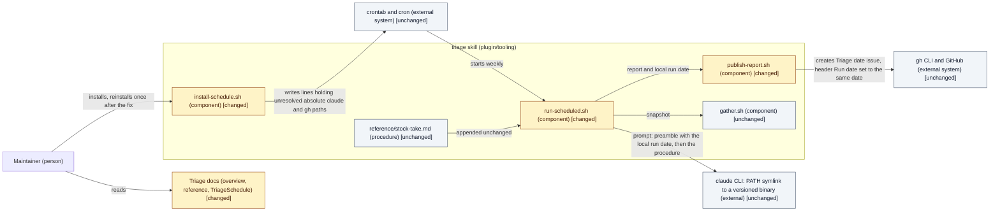

# Design: Triage scheduled-run fixes

> Phase: Design | Started: 2026-11-14 | Status: Draft
> Requirements: [`define/index.md`](../define/index.md) · Session history: [`log.md`](../log.md)

## Contents

- This file only. The primary kind (plugin/tooling) has no in-depth path yet, so there is no `solution.md`. No layer standard applies, and visual UI design is out of scope.

## Prior knowledge

- **Read:**
  - [ADR-010](../../../registry/decisions/010-read-only-scheduled-triage-run.md): the headless model only reads and prints, scripts make every GitHub write, and `stock-take.md` is sent unchanged as the prompt, after the script's preamble. D2 and D3 below are built to keep to it.
  - [Triage overview](../../../explanation/triage/overview.md) (Internal Architecture, Gotchas), [Triage reference](../../../reference/triage/stock-take-and-schedule.md) (Scheduled run, Schedule, Open work), and the constructs [TriageSchedule](../../../reference/constructs/TriageSchedule.md) and [TriageScheduledRun](../../../reference/constructs/TriageScheduledRun.md).
  - Code: `skills/triage/scripts/install-schedule.sh` (`resolve_bin`, lines 74 to 86, and the cron line, line 158), `run-scheduled.sh` (guard, preflight `resolve_bin`, prompt preamble at lines 166 to 175, publish call), `publish-report.sh` (validation and body build), and `skills/triage/reference/stock-take.md` (the report header format).
  - Tests: `tests/triage/lib.sh` (`triage_setup`, the stub binaries), `tests/triage/stubs/claude`, `tests/triage/docs_test.sh` (asserts nothing about #91 or #93).
  - This session: the frozen `define/` and `log.md`.
- **Not read:** any past session folder, including `docs/sessions/archive/`.

## Classification

- **Primary kind:** Plugin/tooling. Every requirement changes the triage skill's scripts (REQ-001 to REQ-003 in `install-schedule.sh`, REQ-004 and REQ-005 in the scheduled run's scripts), their tests, or its docs (REQ-006). There is no UI, service or stored data.
- **In-depth path:** none yet: dkoenawan/compass-labs#51, see Open questions.

Taken as the default under the user's "run it till close" instruction (see Decisions).

## Scope checklist

| Area | In scope? | Reason |
|---|---|---|
| Plugin/tooling (triage scripts and tests) | in | REQ-001 to REQ-005 change `install-schedule.sh`, `run-scheduled.sh` and `publish-report.sh`, and need new tests in `tests/triage/` |
| Documentation | in | REQ-006: the triage explanation, reference and `TriageSchedule` construct docs |
| Frontend | out | No user interface |
| Backend | out | No service or API. The GitHub writes stay as they are (ADR-010) |
| Database | out | No stored data. The crontab line shape is unchanged; only the path it holds changes |
| Infrastructure | out | Cron's PATH and the VM's OAuth token file are #92, a non-goal |
| Process/workflow | out | The maintainer's steps are unchanged, apart from the one-off reinstall REQ-006 documents |
| Visual UI design | out | No screens |
| `reference/stock-take.md` | out (unchanged) | The date goes in the script's preamble (D2), so the procedure stays "sent unchanged" (ADR-010) |
| Other headless runners (`doc-maintainer`, `task-executor`) | out | Non-goal in Define |

## Context view

*Notation: C4 component view (plugin/tooling), drawn as a Mermaid `flowchart` with delta styling.*

## Delta list

Each element this design touches has exactly one status. Every visual matches this list.

| Element | Status | DES | Note |
|---|---|---|---|
| `install-schedule.sh` `resolve_bin` | changed | DES-001 | Absolute path without resolving symlinks, instead of `realpath` |
| `install-schedule.sh` header comment | changed | DES-001 | Says the paths are kept unresolved |
| `run-scheduled.sh` prompt preamble | changed | DES-003 | Adds the local run date |
| `run-scheduled.sh` preflight | unchanged | DES-002 | Already follows the symlink at run time (`-x`, then exec); only tested |
| `publish-report.sh` body build | changed | DES-004 | Sets the header's `- Run date:` line to `<date>` |
| `reference/stock-take.md` | unchanged | — | Still sent unchanged (ADR-010) |
| `gather.sh`, cron line shape, marker, `uninstall-schedule.sh` | unchanged | — | |
| `tests/triage/schedule_test.sh` | changed | DES-001 | Symlinked PATH and override cases |
| `tests/triage/run_scheduled_test.sh` | changed | DES-002, DES-003, DES-004 | Version swap, prompt date, end-to-end header date |
| `tests/triage/publish_report_test.sh` | changed | DES-004 | Header date rewrite |
| `docs/explanation/triage/overview.md` | changed | DES-005 | Drops the #91 and #93 gotchas, adds reinstall guidance |
| `docs/reference/triage/stock-take-and-schedule.md` | changed | DES-005 | Drops #91 and #93 from Open work; states unresolved paths and the header date |
| `docs/reference/constructs/TriageSchedule.md` | changed | DES-005 | Key decision and requirement for unresolved paths |
| `docs/reference/constructs/TriageReportPublisher.md`, `TriageScheduledRun.md` | changed | DES-005 | One line each for the header date and the prompt date |

## Components (DES)

Each item names the `REQ-*` it covers, the result Implement must produce, the check that shows it's done, and the items it depends on.

| ID | Component | Covers | Result | Check | Depends on |
|---|---|---|---|---|---|
| DES-001 | Installer path resolution, `skills/triage/scripts/install-schedule.sh` `resolve_bin` | REQ-001, REQ-002 | `resolve_bin` no longer calls `realpath` (D1). Its last step is `[[ "$found" = /* ]] \|\| found="$PWD/$found"`, then `echo "$found"`, for both the PATH lookup and a `TRIAGE_*_BIN` override. A relative path is made absolute against the current directory, and no symlink is followed or resolved. The existing executable check, the `%`/`'`/newline refusal and the cron line shape stay as they are. The header comment says the paths are absolute and not symlink-resolved. Two new cases in `tests/triage/schedule_test.sh` | (a) REQ-001's criterion: a PATH dir whose `claude` and `gh` are symlinks to `{tmp}/versions/1.0.0/{claude,gh}` stubs, with both overrides unset, gives lines holding `TRIAGE_CLAUDE_BIN='{dir}/claude'` and `TRIAGE_GH_BIN='{dir}/gh'` and no `versions/1.0.0`. (b) REQ-002's criterion: run from a directory holding a `bin/claude` symlink, with `TRIAGE_CLAUDE_BIN=bin/claude`, gives `TRIAGE_CLAUDE_BIN='{cwd}/bin/claude'`. The existing schedule tests still pass | — |
| DES-002 | Scheduled run across a version swap, test in `tests/triage/run_scheduled_test.sh` | REQ-003 | No change to `run-scheduled.sh`: its preflight already checks `-x` and runs the path, which follows the symlink at run time. A test that installs with `claude` a symlink to a `versions/1.0.0` stub, deletes 1.0.0, points the symlink at a `versions/1.0.1` stub, then runs `run-scheduled.sh` with the installed line's `TRIAGE_CLAUDE_BIN`, `TRIAGE_GH_BIN` and arguments at the installed local day and time. Each versioned stub records its version (for example to a file under `$T`) and then execs `tests/triage/stubs/claude` | REQ-003's criterion: the day's log has `step preflight: ok`, and the recorded version is 1.0.1 | DES-001 |
| DES-003 | Prompt preamble, `skills/triage/scripts/run-scheduled.sh` | REQ-004 | The preamble heredoc gains one line naming the guard's `LOCAL_DATE` and `ZONE` and telling the model to write it as the header's `- Run date:` (for example: `The run's local date is $LOCAL_DATE ($ZONE). Write it in the header as "- Run date: $LOCAL_DATE"; don't use a date from your own clock.`). `stock-take.md` is still appended unchanged (D2) | REQ-004's criterion: with `sat 01:00 Pacific/Auckland` and `TRIAGE_NOW="2026-11-20 12:00Z"`, `$CLAUDE_STUB_LOG.prompt` contains `2026-11-21`, and its tail after the preamble is byte-identical to `stock-take.md` | — |
| DES-004 | Header date backstop, `skills/triage/scripts/publish-report.sh` body build | REQ-005 | When building the body (before the length check), the `## Header` section's first `- Run date:` line becomes `- Run date: <date>`, the same `<date>` the title uses (D3). If the header has no `- Run date:` line, one is added as the header's first item. Nothing outside the `## Header` section changes, and validation still runs on the report as given. When the date was changed, the script prints one line saying so (it goes to the run log). The usage comment documents it | (a) `publish_report_test.sh`: a report whose header says `- Run date: 2026-11-20`, published with date `2026-11-21`, gives a created body whose header says `- Run date: 2026-11-21`, with the rest of the report unchanged; a header with no Run date line gets one. (b) REQ-005's criterion end to end in `run_scheduled_test.sh`: the created issue's title is `Triage 2026-11-21` and its body says `- Run date: 2026-11-21` | — |
| DES-005 | Triage docs: `docs/explanation/triage/overview.md`, `docs/reference/triage/stock-take-and-schedule.md`, `docs/reference/constructs/TriageSchedule.md` (plus one line each in `TriageScheduledRun.md` and `TriageReportPublisher.md`) | REQ-006 | The overview drops the "pins a versioned `claude` binary" and "header's run date is the model's own" gotchas and #91, #93 from Open work, and adds a gotcha: a schedule installed before this fix holds a resolved, versioned path, so run `uninstall-schedule.sh <repo>` then `install-schedule.sh <repo> …` once. The reference drops the #91 and #93 Open work rows, says the cron line's binary paths are absolute with symlinks kept, and says the publisher sets the header's Run date to the title's date. `TriageSchedule.md` replaces the `realpath` key decision with the unresolved-path one and adds a requirement line for it. The run and publisher constructs each gain a requirement line for the prompt date and the header date | REQ-006's criterion: none of the three named docs lists #91 or #93 as an open limitation or open work, and the overview names `uninstall-schedule.sh` then `install-schedule.sh` for an older schedule. `tests/run.sh` still passes | DES-001, DES-003, DES-004 |

**Coverage:** all 6 live REQs covered (REQ-001, REQ-002: DES-001; REQ-003: DES-002; REQ-004: DES-003; REQ-005: DES-004; REQ-006: DES-005). No deferred or struck rows.

**Implementation order** (from Depends on): DES-001 → DES-002; DES-003, DES-004 (independent, any order); then DES-005 last, so the docs describe what was built.

## Decisions

Every choice below was taken as the recommended default, not asked, because the user told the orchestrator to run the session to Close without stopping (log, 2026-11-14 "run to Close"). Each is recorded so the gate reviewer can overturn it. D1 was changed at the Design gate (portability). D2 and D3 stand as defaults.

**D1: How the installer makes a path absolute without resolving symlinks (no ADR).**

| Option | Pros | Cons |
|---|---|---|
| **Prefix `$PWD/` when the path isn't absolute, in plain bash: `[[ "$found" = /* ]] \|\| found="$PWD/$found"` (chosen)** | Portable: no `realpath` call, so it works the same with GNU, macOS and BSD userlands. Follows no symlink, and keeps `..` exactly as written. Handles a relative override and a relative PATH entry alike | Leaves any `./` or `..` segments in the cron line as written (harmless, since the path still resolves at run time) |
| `realpath -s` (GNU `--no-symlinks`) | One-word change to the existing line | GNU-only: macOS and BSD `realpath` have no `-s`, and this plugin is publicly distributed. Also normalises `..` lexically, so `link/../x` becomes `x` |

Rejected `realpath -s` for portability. The coordinator chose the bash prefix at the Design gate ("adjust D1").

**D2: Where the local run date reaches the model (ADR-010 applies).**

| Option | Pros | Cons |
|---|---|---|
| **One line in `run-scheduled.sh`'s prompt preamble (chosen)** | `stock-take.md` stays "sent unchanged" (ADR-010). The interactive stock-take is untouched (a Define non-goal). One line of code | The procedure file doesn't itself say where the date comes from in a scheduled run |
| A `{run-date}` placeholder in `stock-take.md`, substituted by the script | The date sits right at the header format | Changes the procedure and contradicts ADR-010's "sent unchanged". The interactive mode would then need its own date rule |

Chosen because it keeps ADR-010 and the interactive mode as they are. Default taken under the run-to-Close instruction.

**D3: Where the published header's Run date is made exact (ADR-010 applies; no new ADR).**

| Option | Pros | Cons |
|---|---|---|
| **`publish-report.sh` sets the header line from its `<date>` argument while building the body (chosen)** | The title and the header come from the same argument in the same place. The publisher already builds the body (it prepends the missing-label note). Tested by the existing `publish_report_test.sh` with no run needed | The publisher now edits one line of the model's report, not only validates and wraps it |
| `run-scheduled.sh` rewrites the report file before calling the publisher | The publisher stays validate-and-write only | The date logic is split across two scripts, and the rewrite is only testable through a whole scheduled run |
| The publisher refuses a report whose Run date differs | The model's text is never changed | A wrong date would publish nothing that week, which defeats NEED-01's "a report every week" |

Chosen because one script then owns the report's date in both places, in keeping with ADR-010's "deterministic scripts own every GitHub write". Default taken under the run-to-Close instruction.

## Principles check

| Item | KISS | YAGNI | SOLID |
|---|---|---|---|
| DES-001 | met: one bash test replaces one call | met | SRP met (resolve_bin still only resolves); OCP n/a: a fix in place; LSP n/a: no substitutable types; ISP met: the cron line's interface is unchanged; DIP met: the binaries stay injected by `TRIAGE_*_BIN` |
| DES-002 | met: a test only, no code | met | SRP met; OCP, LSP, ISP n/a: test code; DIP met: versioned stubs injected through the path |
| DES-003 | met: one preamble line | met | SRP met; OCP met: `stock-take.md` is not modified; LSP n/a; ISP met; DIP met |
| DES-004 | met: one line edit in the body build | met: the missing-line insert serves REQ-005's "shall be", not a general rewriter | SRP met: body building already lives here; OCP met: validation unchanged; LSP n/a; ISP met: the four-argument interface is unchanged; DIP met |
| DES-005 | met | met: only the docs that name #91 and #93, plus one line per affected construct | n/a: documentation, not software |
| D1 | met | met | n/a: a choice of path handling, covered under DES-001 |
| D2 | met | met | OCP met: the procedure file stays closed to this change |
| D3 | met | met | SRP met: one script owns the report's date |

No principle is *traded off*.

**Rejected under YAGNI:**
- Rewriting existing crontab lines in place, or a migration script: a Define non-goal; REQ-006 documents the reinstall instead.
- A run-time fallback in `run-scheduled.sh` that searches PATH when `TRIAGE_CLAUDE_BIN` is missing: REQ-001 to REQ-003 are met by the installer writing the stable path, and preflight already falls back only when the variable is unset.
- Changing the interactive stock-take's date: a Define non-goal.
- Applying the same fix to `doc-maintainer` or `task-executor` installers: a Define non-goal.

## Risks

| Risk | Mitigation |
|---|---|
| A maintainer's existing schedule keeps its old resolved path and still breaks on the next update | DES-005's reinstall gotcha in the overview; the run log's preflight failure already names `TRIAGE_CLAUDE_BIN`, which points to it |
| A relative path with `./` or `..` segments goes into the cron line as written | It still resolves the same way at run time, because it's anchored at the install directory. The installer's executable check runs on the same path, so a broken path fails at install, not silently at run time |
| The rewrite in DES-004 touches a line outside the `## Header` section, for example an issue body quoted in an entry that contains `- Run date:` | DES-004 limits the edit to the `## Header` section, which `publish-report.sh`'s parser already delimits; the test includes an entry body holding a `- Run date:` line that must stay as it is |
| A test leaves a symlink or versioned stub outside `$T`, or touches the real `claude` | DES-001 and DES-002 build every symlink and stub under `triage_setup`'s `$T`; `isolation_test.sh` still runs |

## Open questions

All questions resolved. The plugin/tooling kind has no in-depth path yet, so this design covers it in the all-kinds sections only: dkoenawan/compass-labs#51.
