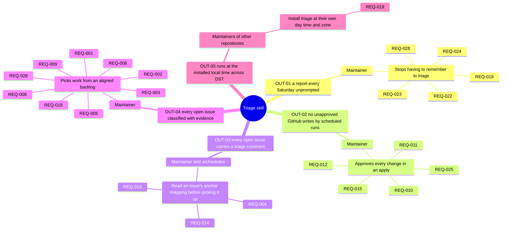
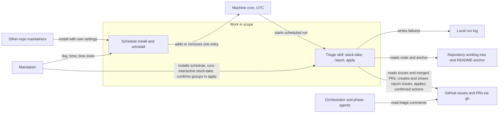
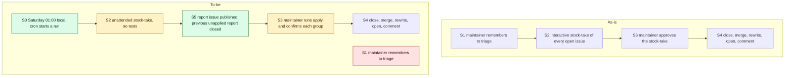

<!-- tier: full. Rendering rules: skills/requirements/reference/diagrams.md -->
# Diagrams: Triage skill

> Part of [index](index.md) · Define

## Impact map

## Context diagram

## Traceability

```mermaid
flowchart LR
  classDef must fill:#DCFCE7,stroke:#166534,color:#052E16
  classDef should fill:#FEF3C7,stroke:#92400E,color:#451A03
  classDef could fill:#F1F5F9,stroke:#475569,color:#0F172A
  O01["OUT-01"]
  O02["OUT-02"]
  O03["OUT-03"]
  O04["OUT-04"]
  O05["OUT-05"]
  N01["NEED-01"]
  N02["NEED-02"]
  N03["NEED-03"]
  N04["NEED-04"]
  R001["REQ-001"]:::must --> O04
  R002["REQ-002"]:::must --> O04
  R002 --> N01
  R003["REQ-003"]:::must --> O04
  R004["REQ-004"]:::must --> O03
  R004 --> N03
  R005["REQ-005"]:::must --> N04
  R005 --> O04
  R006["REQ-006"]:::must --> O04
  R006 --> N03
  R007["REQ-007"]:::should --> N03
  R008["REQ-008"]:::must --> O04
  R008 --> N01
  R009["REQ-009"]:::should --> N01
  R009 --> O04
  R028["REQ-028"]:::must --> O01
  R028 --> O04
  R028 --> N01
  R010["REQ-010"]:::must --> O02
  R010 --> N02
  R011["REQ-011"]:::must --> O02
  R011 --> N02
  R012["REQ-012"]:::must --> N02
  R012 --> O02
  R013["REQ-013"]:::must --> N02
  R014["REQ-014"]:::must --> N02
  R014 --> O03
  R015["REQ-015"]:::must --> N02
  R015 --> O02
  R016["REQ-016"]:::should --> O03
  R016 --> N03
  R017["REQ-017"]:::should --> N02
  R018["REQ-018"]:::could --> N01
  R018 --> O04
  R019["REQ-019"]:::must --> O01
  R019 --> O05
  R019 --> N01
  R019 --> N04
  R020["REQ-020"]:::must --> N04
  R021["REQ-021"]:::should --> N04
  R022["REQ-022"]:::should --> O01
  R022 --> N01
  R023["REQ-023"]:::should --> O01
  R024["REQ-024"]:::should --> O01
  R025["REQ-025"]:::must --> N02
  R025 --> O02
```

## As-is and to-be

